# 智慧企业知识财富库系统 V2.0
## 个人项目小结与考核材料

| 项目 | 内容 |
|---|---|
| 项目名称 | 智慧企业知识财富库系统（Enterprise Knowledge Wealth Base） |
| 项目版本 | V2.0 |
| 文档日期 | 2026-10-29 |
| 项目性质 | 软件工程课程大作业 |
| 项目人数 | 1 人独立完成 |
| 本人角色 | 项目组长，并同时承担需求、设计、前端、后端、测试、文档、运维等全部成员职责 |
| 技术栈 | Vue 3 + Vite、Flask 3 REST API、SQLAlchemy、SQLite、ECharts、jieba |
| 主要交付 | 可运行系统、REST API、10 张 UML 图、需求/设计/测试/项目管理文档、页面截图与自动化测试 |
| 共享工作区 | `E:\网站\测试框架\项目实践\大作业` |

> 本文是课程大作业的个人项目小结与考核材料索引，严格覆盖学校要求的五部分：
> 1. 用例图及用例规格说明；
> 2. 页面原型设计及说明；
> 3. 用例实现顺序/时序图及说明；
> 4. 系统/模块类图及说明；
> 5. 数据库实体类图及 E-R 图及说明。
> 每一部分均给出图引用、图例、关键元素解释、需求追踪与代码对应关系，并在文末汇总个人分工、开发任务、文档任务、完成情况、项目小结和证据路径。\n>\n> **编号说明**：本文以“学校五项个人材料”的 1～5 作为第 1～5 章；若与其他课程文档的总章节编号（例如把项目概述列为第 1 章）不同，以本文第 1～5 章的标题和内容为准，五项材料的顺序不变。

---

## 0. 个人承担说明与交付总览

### 0.1 单人完成声明

本项目为 **2026-10-29 提交的 V2.0 版本**，由本人 **1 人独立完成**。项目没有第二成员，因此不存在“组长只做协调、成员分别做模块”的分工。本人同时承担：

- 项目组长：范围冻结、计划编排、里程碑检查、风险控制、交付统稿；
- 需求负责人：竞品调研、用户需求、系统需求、验收标准；
- 架构与建模负责人：前后端分层、数据库设计、UML 全套图；
- 前端负责人：Vue 3 + Vite 页面、路由、会话、交互与 ECharts 图表；
- 后端负责人：Flask 3 REST API、Flask-Login 会话、SQLAlchemy 模型、权限与审计；
- RAG/图谱负责人：jieba 分词、知识片段切分、检索打分、来源合并、图谱同步；
- 测试负责人：权限矩阵、API 契约、RAG 算法、登录安全、系统回归；
- 文档与运维负责人：Markdown 文档、截图、PlantUML 本地渲染、启停脚本与健康检查。

因此，本文中的“个人分工”不是团队分工表，而是 **同一名项目成员在不同工程角色下的职责矩阵**；“完成情况”以工作区中可核对的代码、文档、图片和脚本为准。

**模块负责人矩阵（全部由本人担任）**

| 模块 | 模块负责人 | 主要交付 |
|---|---|---|
| 认证与安全 | 本人 | 登录/退出、会话、密码哈希、登录限流、失败审计 |
| 知识文档 | 本人 | 列表/检索/详情/新建/编辑/删除、片段与图谱同步 |
| 收藏与分类 | 本人 | 个人收藏切换、收藏列表、分类列表与管理员新增 |
| 智能问答（RAG） | 本人 | 权限过滤、jieba 检索、Top-K、来源、历史、模式降级 |
| 知识图谱 | 本人 | 自动同步、权限裁剪、ECharts 可视化、管理员维护 |
| 用户与审计管理 | 本人 | 用户目录、审计筛选与分页 |
| 关于与健康检查 | 本人 | 关于页统计、`/api/about`、`/api/health`、兼容 `/health` |
| 前端壳层与交互 | 本人 | Vue 路由、AppShell、全局样式、错误/空状态、图表组件 |
| 文档与工程化 | 本人 | 需求/设计/测试/项目文档、UML、截图、启停与测试脚本 |

### 0.2 角色与职责矩阵

| 工程角色 | 本人承担的具体职责 | 主要产出 | 状态 |
|---|---|---|---|
| 项目组长 | 确定 V2.0 范围，安排需求、设计、开发、测试、文档里程碑，检查交付完整性 | `docs/06-项目管理.md`、`README.md`、本文 | 完成 |
| 需求分析 | 整理业务痛点、用户角色、功能需求、非功能需求、需求追踪 | `docs/01-竞品调研报告.md`、`docs/02-用户需求说明书.md`、`docs/03-系统需求说明书.md` | 完成 |
| 系统设计 | 设计表现层、REST API 层、服务层、ORM 层、SQLite 存储层 | `docs/04-软件设计说明书.md`、`docs/uml/` | 完成 |
| UML 建模 | 绘制用例图、登录时序图、RAG 时序图、活动图、状态图、类图、E-R 图、部署图、构件图、三层架构图 | `docs/uml/*.puml`、`docs/uml/rendered/*.png`、`*.svg` | 完成 |
| Vue 前端 | 登录、工作台、文档列表/详情/编辑、问答、图谱、用户、审计、关于共 10 类页面 | `frontend/src/views/`、`frontend/src/components/` | 完成 |
| Flask 后端 | API 蓝图、认证会话、文档 CRUD、收藏、分类、问答、图谱、管理、关于、健康检查 | `app/api.py`、`app/models.py`、`app/services/` | 完成 |
| 数据治理 | 密级可见性、部门隔离、状态控制、收藏唯一约束、审计留痕、来源可追溯 | `app/services/rag.py`、`app/models.py`、`app/utils.py` | 完成 |
| 测试与质量 | API 契约、权限矩阵、RAG 算法、登录防爆破、失败审计、系统回归 | `tests/test_*.py`、`run_tests.ps1`、`docs/05-测试报告.md` | 完成 |
| 工程化 | Vite 代理、后台启停、UML 本地渲染、环境变量配置、健康检查 | `frontend/vite.config.js`、`start.ps1`、`stop.ps1`、`scripts/` | 完成 |

### 0.3 五部分交付符合性检查

| 学校要求 | 本文对应位置 | 图引用 | 代码/需求证据 | 完成情况 |
|---|---|---|---|---|
| 1. 用例图及用例规格说明 | 第 1 章 | `docs/uml/rendered/01-用例图.png` | `docs/uml/01-用例图.puml`、`app/api.py`、`frontend/src/router/index.js` | 已覆盖 |
| 2. 页面原型设计及说明 | 第 2 章 | `docs/screenshots/01-login.png` 至 `docs/screenshots/10-about.png` | `frontend/src/views/*.vue`、`frontend/src/components/AppShell.vue` | 页面已实现；截图按交付清单归档 |
| 3. 用例实现顺序/时序图及说明 | 第 3 章 | `02-登录时序图.png`、`03-RAG问答时序图.png`、`04-文档发布活动图.png`、`05-文档状态图.png` | `frontend/src/api/client.js`、`app/api.py`、`app/services/rag.py` | 已覆盖 |
| 4. 系统/模块类图及说明 | 第 4 章 | `06-类图.png`，辅以 `09-构件图.png`、`10-三层架构.png` | `app/models.py`、`app/services/`、`frontend/src/` | 已覆盖 |
| 5. 数据库实体类图及 E-R 图及说明 | 第 5 章 | `06-类图.png`（ORM 视角）、`07-ER图.png`（关系视角） | `app/models.py`、`instance/knowledge.db` 的 SQLAlchemy 映射 | 已覆盖 |
| 个人分工、开发/文档任务、完成情况、小结、证据 | 第 0、6、7 章 | 本文表格与证据索引 | 工作区全部交付物 | 已完成 |

### 0.4 完成情况量化

统计口径：截至 2026-10-29，按当前共享工作区文件统计；不包含 `node_modules`、构建产物和第三方依赖。

| 指标 | 数量 | 说明 |
|---|---:|---|
| UML 源文件 | 10 | 用例、时序、活动、状态、类、ER、部署、构件、三层架构 |
| UML 渲染图 | 10 组 PNG + SVG | `docs/uml/rendered/` |
| 前端页面 | 10 类业务页面，另有 404 页 | 登录、工作台、文档列表/详情/编辑、问答、图谱、用户、审计、关于 |
| REST API 端点 | 27 个主要方法/路径组合 | 另有 `/api/` 根路径别名与兼容 `/health` |
| 后端与前端源文件 | 43 个 | `app/**/*.py` 与 `frontend/src/**/*.vue,*.js` |
| 源代码行数 | 约 6387 行 | 不含依赖与构建产物，用于说明独立完成规模 |
| 自动化测试函数 | 120 个 | 5 个 `tests/test_*.py` 文件；参数化后实际执行用例更多 |
| 数据库表 | 9 张 | users、categories、documents、knowledge_chunks、graph_nodes、graph_edges、favorites、audit_logs、qa_history |
| 页面截图引用 | 10 张 | 按 `01-login.png` 至 `10-about.png` 的交付命名组织 |

---

## 1. 用例图及用例规格说明

### 1.1 用例图

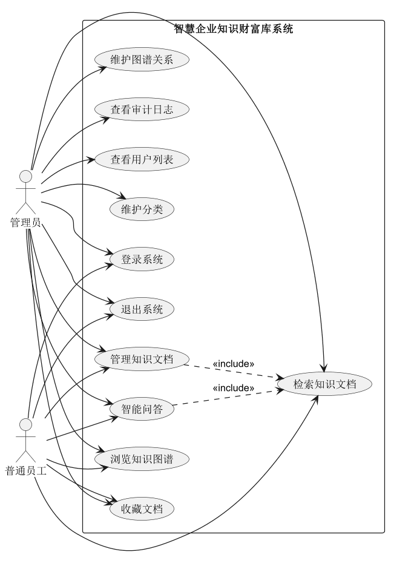

**图 1-1 说明**：系统参与者分为“普通员工”和“管理员”。普通员工可登录、退出、管理知识文档、检索文档、智能问答、浏览图谱和收藏文档；管理员在此基础上增加维护分类、维护图谱关系、查看审计日志、查看用户列表等治理能力。“管理知识文档”和“智能问答”均包含“检索知识文档”能力。

**图源**：[`docs/uml/01-用例图.puml`](../uml/01-用例图.puml)
**渲染图**：[`docs/uml/rendered/01-用例图.png`](../uml/rendered/01-用例图.png)

### 1.2 图例与关键元素

| 图元素 | 含义 | 本项目对应 |
|---|---|---|
| 火柴人 | 系统外部参与者 | 普通员工、管理员；管理员是普通员工能力的超集 |
| 矩形边框 | 系统边界 | V2.0 Vue 3 SPA + Flask REST API 系统 |
| 椭圆 | 用例/业务目标 | 登录、检索、问答、图谱、审计等 |
| 实线 | 参与者与用例的关联 | 谁能发起该用例 |
| 虚线箭头 `<<include>>` | 被包含的必需子流程 | 管理文档、智能问答均必须调用检索能力 |
| 用例粒度 | 以用户可感知目标划分 | “管理知识文档”内部再细分增删改查，规格说明中展开 |

**关键解释**：

1. **普通员工不是“只读用户”**。当前实现允许已登录员工新建文档；编辑、删除仅限本人文档，管理员可编辑/删除全部文档。
2. **管理员权限不是独立业务系统**。管理员仍复用普通员工的文档、问答、图谱能力，只是额外拥有分类维护、图谱维护、用户查看和审计查看入口。
3. **检索是共享能力**。文档列表检索和 RAG 问答共享同一套“可访问文档”判定，但用途不同：前者返回文档卡片，后者返回知识片段和答案来源。
4. **机密隔离是跨用例约束**。无论列表、详情、问答还是图谱，均先按当前用户权限过滤；权限规则在 `app/services/rag.py` 的 `can_view_document()` 与 `searchable_documents()` 中集中实现。

### 1.3 用例清单与需求追踪矩阵

| 编号/用例 | 参与者与权限 | 需求编号 | 主要页面/API | 代码与验证证据 |
|---|---|---|---|---|
| UC-01 登录系统 | 普通员工、管理员；公开接口，失败限流 | UR-AUTH-01/05/06/07；SR-AUTH-001/002/007/008/009 | `/login`；`POST /api/auth/login` | `app/api.py`、`app/blueprints/auth.py`、`LoginView.vue`；`tests/test_api.py`、`test_login_security.py` |
| UC-02 退出系统 | 普通员工、管理员；必须已登录 | UR-AUTH-02；SR-AUTH-003 | 顶部退出；`POST /api/auth/logout` | `app/api.py`、`AppShell.vue`；`tests/test_api.py` |
| UC-03 管理知识文档 | 普通员工、管理员；新建已登录，编辑/删除仅作者或管理员 | UR-DOC-01/03/04/05；SR-DOC-001/004/005/006/007 | `/documents`、`new/edit`；文档 CRUD API | `app/api.py`、`DocumentEditorView.vue`；`tests/test_api.py`、`test_security.py` |
| UC-04 检索知识文档 | 普通员工、管理员；仅已发布且可见文档 | UR-DOC-02；SR-DOC-001/002/003/009；SR-QA-008 | `/documents?q=...`；`GET /api/documents` | `app/api.py`、`app/services/rag.py`；`tests/test_api.py`、`test_security.py` |
| UC-05 智能问答 | 普通员工、管理员；仅检索可见片段 | UR-QA-01/02/03/04；SR-QA-001～009 | `/qa`；`GET /api/qa`、`POST /api/qa/ask` | `app/services/rag.py`、`QaView.vue`；`tests/test_api.py`、`test_rag.py` |
| UC-06 浏览知识关系图 | 普通员工、管理员；从可见文档节点裁剪 | UR-KG-01；SR-KG-001/002/003/005 | `/graph`；`GET /api/graph` | `app/services/graph.py`、`GraphView.vue`；`tests/test_api.py`、`test_security.py` |
| UC-07 收藏文档 | 普通员工、管理员；仅限通过密级判定的文档 | UR-FAV-01；SR-FAV-001/002/003 | 列表/详情收藏按钮；收藏 API | `app/api.py`、`app/models.py`；`tests/test_api.py` |
| UC-08 维护分类 | 管理员新增；所有登录用户可读列表 | UR-DOC-06；SR-DOC-008 | 文档表单分类；`GET/POST /api/categories` | `app/api.py`、`app/models.py`；`tests/test_api.py`、`test_security.py` |
| UC-09 维护图谱关系 | 管理员 | UR-KG-02；SR-KG-004 | 图谱维护弹窗；图谱管理 API | `app/api.py`、`app/services/graph.py`；`tests/test_api.py` |
| UC-10 查看审计日志 | 管理员 | UR-AUD-01；SR-AUD-001/002 | `/admin/audits`；`GET /api/admin/audits` | `app/api.py`、`AuditsView.vue`；`tests/test_api.py`、`test_login_security.py` |
| UC-11 查看用户列表 | 管理员 | UR-AUTH-03；SR-AUTH-004 | `/admin/users`；`GET /api/admin/users` | `app/api.py`、`UsersView.vue`；`tests/test_api.py`、`test_security.py` |
### 1.4 用例规格说明

#### UC-01 登录系统

| 项目 | 规格 |
|---|---|
| 用例编号/名称 | UC-01 登录系统 |
| 参与者 | 普通员工、管理员 |
| 目标 | 以用户名和密码建立服务端会话，并进入工作台 |
| 前置条件 | 系统可访问；用户拥有系统账号 |
| 触发事件 | 用户在登录页提交用户名、密码 |
| 主成功场景 | 1. 前端 `POST /api/auth/login` 提交 JSON；2. 服务端检查来源 IP 是否处于锁定窗口；3. 查询用户并用带盐哈希校验密码；4. 成功则清零失败计数、写入 `login` 审计、建立 Flask-Login 会话；5. 返回用户资料；6. 前端跳转工作台。 |
| 异常/分支 | 用户名或密码错误：记录失败计数与 `login_failed` 审计，返回 401；窗口内失败达到阈值：后续请求返回 429 和 `retry_after`；请求体缺少字段按错误凭据处理。 |
| 后置条件 | 成功：会话存在、审计落库；失败：无会话，失败事件进入限流器和审计。 |
| 权限/数据规则 | 登录接口公开；密码不落明文；会话 Cookie 为 HttpOnly、SameSite=Lax。 |
| 需求追踪 | UR-AUTH-01/05/06/07；SR-AUTH-001/002/007/008/009 |
| 实现位置 | `app/api.py::login`、`app/blueprints/auth.py::login_limiter`、`app/utils.py::RateLimiter`、`frontend/src/stores/session.js` |
| 验证证据 | `tests/test_api.py::test_api_login_logout_flow`、`tests/test_login_security.py` |

#### UC-02 退出系统

| 项目 | 规格 |
|---|---|
| 用例编号/名称 | UC-02 退出系统 |
| 参与者 | 普通员工、管理员 |
| 目标 | 终止当前会话并留下退出审计 |
| 前置条件 | 当前用户已登录 |
| 触发事件 | 点击顶部退出入口，或调用退出 API |
| 主成功场景 | 1. 前端 `POST /api/auth/logout`；2. 服务端写入 `logout` 审计；3. 调用 `logout_user()` 清除会话；4. 返回“已退出登录”；5. 前端清理用户状态并跳转登录页。 |
| 异常/分支 | 未登录调用返回 401 `AUTH_REQUIRED`；网络异常时前端保留提示。 |
| 后置条件 | 会话失效，审计中包含退出记录。 |
| 权限/数据规则 | 必须已登录；只能退出当前会话。 |
| 需求追踪 | UR-AUTH-02；SR-AUTH-003 |
| 实现位置 | `app/api.py::logout`、`frontend/src/components/AppShell.vue` |
| 验证证据 | `tests/test_api.py::test_api_login_logout_flow` |

#### UC-03 管理知识文档

| 项目 | 规格 |
|---|---|
| 用例编号/名称 | UC-03 管理知识文档 |
| 参与者 | 普通员工、管理员 |
| 目标 | 创建、查看、编辑、删除知识文档，并自动建立检索片段与图谱关系 |
| 前置条件 | 已登录；编辑/删除时当前用户是作者或管理员 |
| 触发事件 | 点击“新建文档”“编辑”“删除”或保存表单 |
| 主成功场景 | 1. 用户填写标题、正文、摘要、分类、部门、密级、状态、版本、标签；2. 前端调用 `POST /api/documents` 或 `PUT /api/documents/{id}`；3. 服务端校验标题与正文；4. 写入/更新 `documents`；5. 重建 `knowledge_chunks`；6. 同步图谱节点与边；7. 写入审计并返回文档详情。 |
| 异常/分支 | 标题或正文为空：400 `VALIDATION_ERROR`；分类不存在：400；非作者且非管理员编辑/删除：403；文档不存在：404；草稿/归档仅作者和管理员可见详情。 |
| 后置条件 | 文档、知识片段、图谱和审计保持一致。 |
| 权限/数据规则 | 列表只返回当前用户可见的已发布文档；密级规则见 UC-04；部门为空时使用当前账号部门；密级/状态非法值回退为 `internal`/`published`。 |
| 需求追踪 | UR-DOC-01/03/04/05；SR-DOC-001/004/005/006/007 |
| 实现位置 | `app/api.py::_apply_document_payload`、`create_document`、`update_document`、`delete_document`；`app/services/rag.py::rebuild_chunks_for_document`；`app/services/graph.py::sync_document_graph` |
| 验证证据 | `tests/test_api.py::test_api_document_crud_and_favorite`、`tests/test_security.py` |

#### UC-04 检索知识文档

| 项目 | 规格 |
|---|---|
| 用例编号/名称 | UC-04 检索知识文档 |
| 参与者 | 普通员工、管理员 |
| 目标 | 在权限范围内按关键词、分类、部门、密级检索并分页浏览文档 |
| 前置条件 | 已登录；存在可访问的已发布文档 |
| 触发事件 | 在文档列表输入关键词或选择筛选条件 |
| 主成功场景 | 1. 前端 `GET /api/documents` 携带 `q/category_id/department/visibility/sort/page/per_page`；2. 服务端先取当前用户可见的已发布文档；3. 按分类、部门、密级过滤；4. 有关键词时用 jieba 分词与标题/标签/摘要/正文加权排序；5. 返回分页文档、分类、部门、筛选回显。 |
| 异常/分支 | `page` 超出总页数时钳制到最后一页；`per_page` 限制在 1～50；无结果返回空 `items` 且 `pages=1`；未登录 401。 |
| 后置条件 | 不修改业务数据；查看详情时可能写入查看审计。 |
| 权限/数据规则 | `secret` 仅管理员、同部门用户或作者可见；`public`/`internal` 对已登录用户可见；列表排除草稿和归档。 |
| 需求追踪 | UR-DOC-01/02；SR-DOC-001/002/003/009；SR-QA-008 |
| 实现位置 | `app/api.py::list_documents`、`app/services/rag.py::searchable_documents`、`rank_documents`、`frontend/src/views/DocumentsView.vue` |
| 验证证据 | `tests/test_api.py::test_api_document_search_and_detail`、`tests/test_security.py` |

#### UC-05 智能问答

| 项目 | 规格 |
|---|---|
| 用例编号/名称 | UC-05 智能问答 |
| 参与者 | 普通员工、管理员 |
| 目标 | 基于当前用户有权访问的知识片段生成回答，并展示可追溯来源 |
| 前置条件 | 已登录；文档已发布且已生成知识片段 |
| 触发事件 | 用户输入问题或点击示例问题 |
| 主成功场景 | 1. 前端 `POST /api/qa/ask`；2. 服务端先调用 `searchable_documents(user)` 过滤权限；3. 加载可见文档的 `knowledge_chunks`；4. jieba 分词、评分、取 Top-K（同一文档最多 2 个片段）；5. 无 Key 时生成本地摘要，有 Key 时调用兼容 Chat Completions 的大模型；6. 保存 `qa_history`；7. 写入 `ask_qa` 审计；8. 返回答案、模式、来源和片段。 |
| 异常/分支 | 问题为空：400；无命中：回答明确提示未检索到相关内容；大模型调用失败：回退为本地检索摘要并标记 `local`；历史越权：403。 |
| 后置条件 | 问答历史和审计落库；返回结果带来源文档标题、部门、相关度和片段。 |
| 权限/数据规则 | 问答与列表共用权限过滤；不得返回无权文档的片段正文；普通用户只看本人历史，管理员可看任意历史。 |
| 需求追踪 | UR-QA-01/02/03/04；SR-QA-001～009 |
| 实现位置 | `app/api.py::qa_page`、`ask_question`、`qa_history_detail`；`app/services/rag.py::retrieve`、`group_hits_by_document`、`ask`、`call_llm_answer`；`frontend/src/views/QaView.vue` |
| 验证证据 | `tests/test_api.py::test_api_qa_returns_traceable_sources`、`tests/test_rag.py` |

#### UC-06 浏览知识关系图

| 项目 | 规格 |
|---|---|
| 用例编号/名称 | UC-06 浏览知识关系图 |
| 参与者 | 普通员工、管理员 |
| 目标 | 以力导向图查看文档、部门、关键词、分类/概念之间的连接 |
| 前置条件 | 已登录；图谱中存在与可见文档关联的节点 |
| 触发事件 | 打开 `/graph` 或点击刷新 |
| 主成功场景 | 1. 前端 `GET /api/graph`；2. 服务端生成全量图谱载荷；3. 只保留当前用户可见文档节点；4. 加入与这些文档直接相连的部门/关键词/概念节点；5. 返回裁剪后的 `nodes/links/categories`；6. 前端 ECharts 渲染并支持拖拽、缩放、悬停、点击文档节点跳转。 |
| 异常/分支 | 无可视图谱返回空节点；未登录 401；管理员可打开“维护图谱”弹窗。 |
| 后置条件 | 只读浏览不改变数据；管理员新增节点/边后写入数据库。 |
| 权限/数据规则 | 普通用户看不到仅由隐藏文档连接的节点；节点类型包括 `document/department/project/keyword/concept`。 |
| 需求追踪 | UR-KG-01；SR-KG-001/002/003/005 |
| 实现位置 | `app/api.py::_visible_graph_payload`、`graph_view`；`app/services/graph.py::graph_payload`；`frontend/src/views/GraphView.vue` |
| 验证证据 | `tests/test_api.py::test_api_graph_payload_is_visible_scope`、`tests/test_security.py` |

#### UC-07 收藏文档

| 项目 | 规格 |
|---|---|
| 用例编号/名称 | UC-07 收藏文档 |
| 参与者 | 普通员工、管理员 |
| 目标 | 将当前可见文档加入个人收藏，或取消收藏 |
| 前置条件 | 已登录；目标文档存在且当前用户可查看 |
| 触发事件 | 点击列表卡片或详情页收藏按钮 |
| 主成功场景 | 1. 前端 `POST /api/documents/{id}/favorite`；2. 服务端校验文档存在与可见性；3. 已存在则删除收藏，否则新增收藏；4. 返回 `is_favorite` 状态和提示。 |
| 异常/分支 | 文档不存在：404；无权查看：403；唯一约束 `(user_id, document_id)` 防止重复收藏。 |
| 后置条件 | 收藏状态与文档列表/详情同步；收藏列表仅返回当前用户且仍可见的文档。 |
| 权限/数据规则 | 收藏按用户隔离；管理员也不能代替其他用户收藏。 |
| 需求追踪 | UR-FAV-01；SR-FAV-001/002/003 |
| 实现位置 | `app/api.py::favorite_documents`、`toggle_favorite`；`app/models.py::Favorite` |
| 验证证据 | `tests/test_api.py::test_api_document_crud_and_favorite` |

#### UC-08 维护分类

| 项目 | 规格 |
|---|---|
| 用例编号/名称 | UC-08 维护分类 |
| 参与者 | 管理员；普通员工只读分类列表 |
| 目标 | 为文档建立统一分类及说明 |
| 前置条件 | 新增分类时当前用户为管理员 |
| 触发事件 | 管理员提交分类名称和说明 |
| 主成功场景 | 1. 前端 `POST /api/categories`；2. 校验名称非空且不重复；3. 写入 `categories`；4. 返回新分类 id/name；5. 文档编辑页刷新分类下拉。 |
| 异常/分支 | 名称为空或重复：400；非管理员：403；分类列表未登录：401。 |
| 后置条件 | 分类可供文档引用；当前 API 未暴露删除分类，文档分类通过 `category_id` 可为空表示未分类。 |
| 权限/数据规则 | `GET /api/categories` 所有登录用户可读；`POST /api/categories` 仅管理员。 |
| 需求追踪 | UR-DOC-06；SR-DOC-008 |
| 实现位置 | `app/api.py::categories`、`create_category`；`app/models.py::Category` |
| 验证证据 | `tests/test_api.py`、`tests/test_security.py` |

#### UC-09 维护图谱关系

| 项目 | 规格 |
|---|---|
| 用例编号/名称 | UC-09 维护图谱关系 |
| 参与者 | 管理员 |
| 目标 | 手工补充概念节点和节点间语义关系，弥补自动同步不足 |
| 前置条件 | 当前用户为管理员 |
| 触发事件 | 图谱页点击“维护图谱”，提交新增节点或关系 |
| 主成功场景 | 1. `GET /api/graph/manage` 获取最近节点、边和节点类型；2. `POST /api/graph/nodes` 新增/复用节点；3. `POST /api/graph/edges` 新增关系，必要时自动创建起点/终点概念节点；4. 提交事务后返回成功消息。 |
| 异常/分支 | 节点名为空：400；起点或终点名称为空：400；非管理员：403；同名节点按名称复用。 |
| 后置条件 | 新节点/边进入图谱；管理员管理面板显示最近 60 个节点和边。 |
| 权限/数据规则 | 管理面板与写操作均要求管理员；普通用户只能浏览权限裁剪后的图谱。 |
| 需求追踪 | UR-KG-02；SR-KG-004 |
| 实现位置 | `app/api.py::graph_manage`、`add_graph_node`、`add_graph_edge`；`app/services/graph.py::get_or_create_node`、`ensure_edge` |
| 验证证据 | `tests/test_api.py`、`tests/test_security.py` |

#### UC-10 查看审计日志

| 项目 | 规格 |
|---|---|
| 用例编号/名称 | UC-10 查看审计日志 |
| 参与者 | 管理员 |
| 目标 | 按动作、用户、明细检索关键操作记录，支持审计追溯 |
| 前置条件 | 当前用户为管理员；已有审计数据 |
| 触发事件 | 打开 `/admin/audits` 或设置筛选条件 |
| 主成功场景 | 1. `GET /api/admin/audits`；2. 按 `action/user/detail/page` 过滤；3. 按时间倒序分页（每页 25 条）；4. 返回日志、分页、动作统计和动作选项。 |
| 异常/分支 | 非管理员：403；未登录：401；无效动作被忽略；页码超出时钳制到最后一页。 |
| 后置条件 | 只读；不修改审计记录。 |
| 权限/数据规则 | 仅管理员；审计类型包括 login、login_failed、logout、view_document、create_document、edit_document、delete_document、ask_qa。 |
| 需求追踪 | UR-AUD-01；SR-AUD-001/002；SR-AUTH-007 |
| 实现位置 | `app/api.py::admin_audits`、`_audit_payload`；`frontend/src/views/AuditsView.vue` |
| 验证证据 | `tests/test_api.py`、`tests/test_login_security.py` |

#### UC-11 查看用户列表

| 项目 | 规格 |
|---|---|
| 用例编号/名称 | UC-11 查看用户列表 |
| 参与者 | 管理员 |
| 目标 | 查看账号、角色、部门和文档贡献数量 |
| 前置条件 | 当前用户为管理员 |
| 触发事件 | 打开 `/admin/users` |
| 主成功场景 | 1. `GET /api/admin/users`；2. 服务端查询用户及按作者统计的文档数；3. 返回用户列表与管理员/员工汇总；4. 前端支持本地关键字过滤。 |
| 异常/分支 | 非管理员：403；未登录：401。 |
| 后置条件 | 只读；不修改账号。当前版本账号由种子数据维护，不提供用户新增/删除 API。 |
| 权限/数据规则 | 仅管理员；密码哈希不进入响应；用户资料字段包含 id、username、display_name、role、department、is_admin、created_at。 |
| 需求追踪 | UR-AUTH-03；SR-AUTH-004 |
| 实现位置 | `app/api.py::admin_users`；`frontend/src/views/UsersView.vue` |
| 验证证据 | `tests/test_api.py`、`tests/test_security.py` |

### 1.5 用例与代码对应小结

| 分层 | 主要职责 | 证据 |
|---|---|---|
| Vue 路由与页面 | 把用户操作映射到 REST API，展示错误和状态 | `frontend/src/router/index.js`、`frontend/src/views/` |
| REST API 蓝图 | 统一 `/api` 前缀、JSON 返回、会话与管理员校验 | `app/api.py` |
| 服务层 | RAG 检索问答、图谱同步与权限过滤 | `app/services/rag.py`、`app/services/graph.py` |
| ORM 模型 | 用户、文档、片段、图谱、收藏、审计、问答历史 | `app/models.py` |
| 安全工具 | 密码哈希、限流、安全回跳、审计文案 | `app/utils.py`、`app/blueprints/auth.py` |

---
## 2. 页面原型设计及说明

### 2.1 页面原型总体说明

V2.0 前端为 Vue 3 + Vite 单页应用，统一采用左侧导航 + 顶部身份区 + 主内容区的桌面端工作台布局。登录页采用独立的左右分栏品牌页，不进入工作台壳层；其余业务页在 `AppShell` 内切换。

**截图基线目录**：`docs/screenshots/`。本文按以下预期文件名引用：
`01-login.png`、`02-dashboard.png`、`03-documents.png`、`04-document-detail.png`、`05-document-editor.png`、`06-qa.png`、`07-graph.png`、`08-users.png`、`09-audits.png`、`10-about.png`。
如最终交付批次对文件名做了中文名、日期后缀或大小写调整，以同目录下对应页面的通配文件为准（例如 `docs/screenshots/*login*.png`、`docs/screenshots/*问答*.png`），页面语义和本文章节顺序不变。

**全局图例**：

| 图例/元素 | 含义 |
|---|---|
| 深蓝/蓝紫主按钮 | 当前页面主要动作，如登录、保存、发起问答 |
| 灰色描边按钮 | 次要动作，如刷新、返回、取消 |
| 红色描边/红色徽标 | 高风险或机密状态，如删除、机密、管理员 |
| 绿色/蓝色/灰色状态胶囊 | 公开/内部/机密、已发布/草稿/已归档等状态 |
| 左侧导航 | 工作台、知识文档、智能问答、知识关系图、管理员菜单、关于系统 |
| 顶部身份区 | 当前用户、部门、角色、退出 |
| 空状态/骨架屏 | 加载或检索无结果时的可理解反馈 |
| 响应式断点 | 主要面向桌面浏览器；窄屏时布局收敛，详细限制见页面说明 |

**页面与权限**：

| 页面 | 路由 | 可见角色 | 主要 API |
|---|---|---|---|
| 登录 | `/login` | 匿名 | `GET /api/meta`、`POST /api/auth/login`、`GET /api/auth/session` |
| 工作台 | `/dashboard` | 已登录 | `GET /api/dashboard` |
| 知识文档列表 | `/documents` | 已登录 | `GET /api/documents`、`POST /api/documents/{id}/favorite` |
| 文档详情 | `/documents/:id` | 有文档查看权限的已登录用户 | `GET /api/documents/{id}`、收藏、删除 |
| 文档编辑 | `/documents/new`、`/documents/:id/edit` | 已登录；编辑需作者或管理员 | `GET /api/categories`、`POST /api/documents`、`PUT /api/documents/{id}` |
| 智能问答 | `/qa` | 已登录 | `GET /api/qa`、`POST /api/qa/ask`、`GET /api/qa/history/{id}` |
| 知识关系图 | `/graph` | 已登录；维护弹窗仅管理员 | `GET /api/graph`、`GET /api/graph/manage`、`POST /api/graph/nodes`、`POST /api/graph/edges` |
| 用户管理 | `/admin/users` | 管理员 | `GET /api/admin/users` |
| 审计日志 | `/admin/audits` | 管理员 | `GET /api/admin/audits` |
| 关于系统 | `/about` | 已登录 | `GET /api/about` |

### 2.2 页面原型逐页说明

#### 2.2.1 登录页

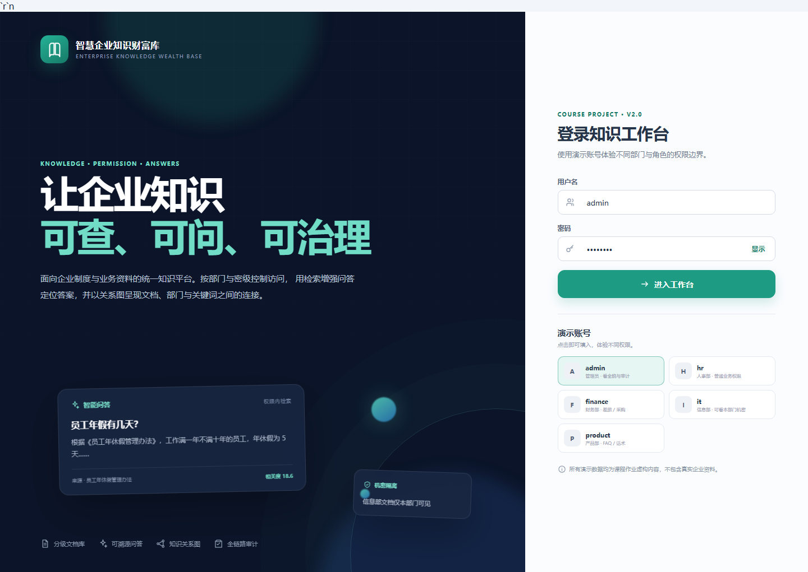

| 项目 | 说明 |
|---|---|
| 对应文件 | `docs/screenshots/01-login.png`；实现：`frontend/src/views/LoginView.vue` |
| 页面目标 | 在未登录状态说明系统价值，并提供账号密码登录与演示账号入口 |
| 主要区域 | 左侧品牌/价值说明/问答与机密隔离示意；右侧登录表单；用户名、密码、显示/隐藏、登录按钮、错误提示、演示账号快捷填充 |
| 关键交互 | 输入或选择演示账号；提交时校验非空；登录成功后跳转 `redirect` 或 `/dashboard`；失败显示统一错误；锁定显示剩余秒数 |
| 数据/API | `GET /api/meta` 获取版本与演示账号；`GET /api/auth/session` 判断已登录；`POST /api/auth/login` 建立会话 |
| 权限/异常 | 公开页；401 提示“用户名或密码错误”；429 提示稍后再试；已登录访问登录页会被路由守卫送回工作台 |
| 需求/代码映射 | UR-AUTH-01/05/06/07；SR-AUTH-001/002/007/008/009；`LoginView.vue`、`stores/session.js`、`router/index.js` |

#### 2.2.2 工作台

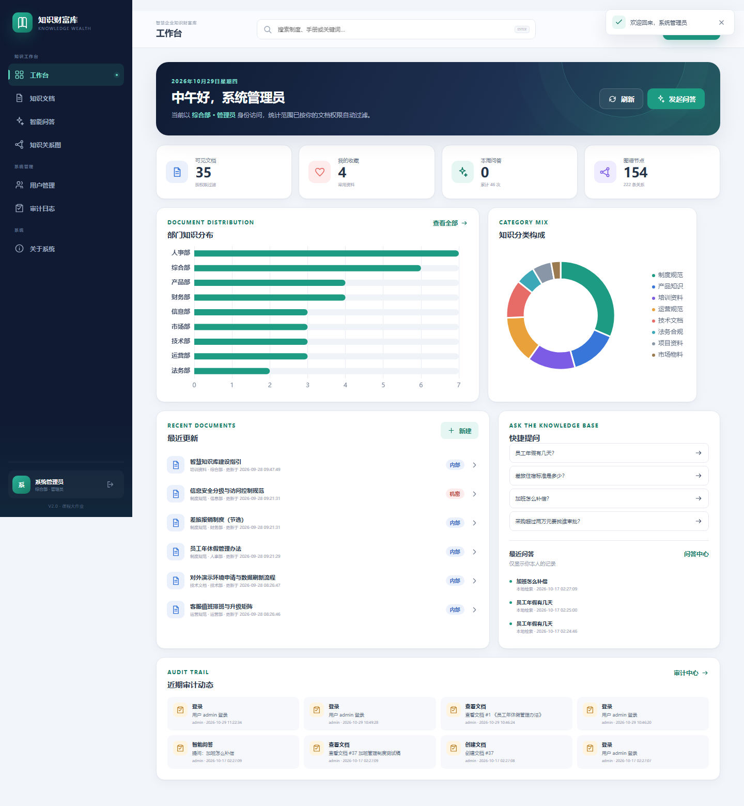

| 项目 | 说明 |
|---|---|
| 对应文件 | `docs/screenshots/02-dashboard.png`；实现：`frontend/src/views/DashboardView.vue` |
| 页面目标 | 登录后提供当前权限范围内的业务概览和快捷入口 |
| 主要区域 | 问候与当前身份、四个统计卡（可见文档、我的收藏、本周问答、图谱节点）、部门知识分布、知识分类构成、最近更新、快捷提问、最近问答、管理员近期审计动态 |
| 关键交互 | 刷新统计；点击统计/最近文档进入详情；点击快捷问题跳转问答页并带入 `q`；管理员点击审计中心进入审计页 |
| 数据/API | `GET /api/dashboard`；ECharts 渲染 `charts.departments` 与 `charts.categories`；最近文档 6 篇、最近问答 6 条、审计动态仅管理员返回 8 条 |
| 权限/异常 | 仅已登录；文档、收藏、问答与图表按当前用户可见范围统计；图谱节点/边为全量结构统计；普通员工不显示审计区块 |
| 需求/代码映射 | SR-OPS-001；`DashboardView.vue`、`BaseChart.vue`、`app/api.py::dashboard` |

#### 2.2.3 知识文档列表

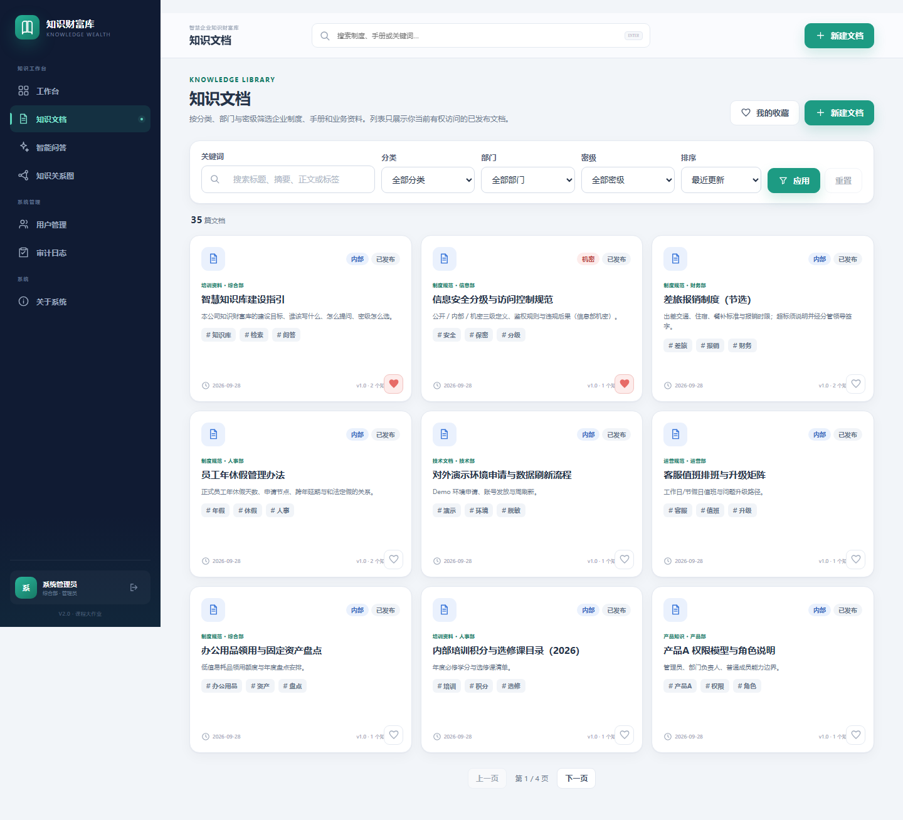

| 项目 | 说明 |
|---|---|
| 对应文件 | `docs/screenshots/03-documents.png`；实现：`frontend/src/views/DocumentsView.vue` |
| 页面目标 | 在权限范围内检索、筛选、分页浏览文档，并快速收藏或新建 |
| 主要区域 | 页面标题与“新建文档”入口；关键词、分类、部门、密级、排序筛选区；结果总数；文档卡片网格；状态/密级徽标；标签；知识片段数；收藏按钮；分页 |
| 关键交互 | 提交筛选；重置筛选；查看收藏集合；卡片进入详情；收藏/取消收藏即时更新；分页保持查询参数 |
| 数据/API | `GET /api/documents`（`q/category_id/department/visibility/sort/page/per_page`）；`POST /api/documents/{id}/favorite` |
| 权限/异常 | 仅返回已发布且当前用户可见文档；无结果展示空状态；未登录由路由守卫重定向登录；收藏失败显示提示 |
| 需求/代码映射 | UR-DOC-01/02；SR-DOC-001/002/003/009；`DocumentsView.vue`、`app/api.py::list_documents` |

#### 2.2.4 文档详情

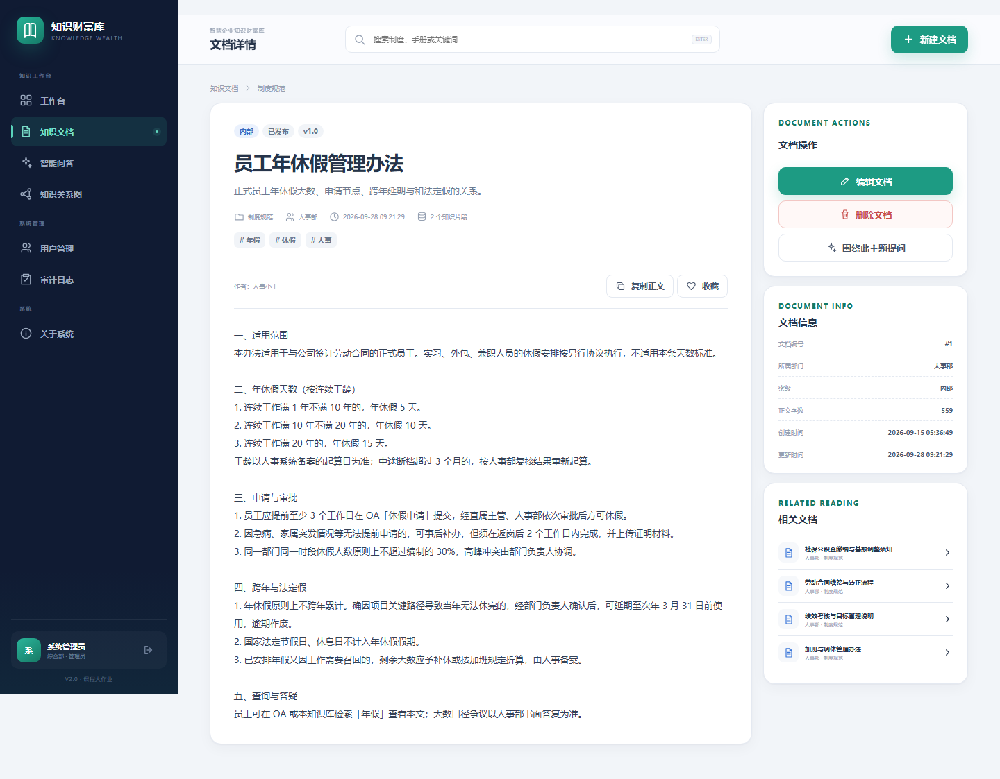

| 项目 | 说明 |
|---|---|
| 对应文件 | `docs/screenshots/04-document-detail.png`；实现：`frontend/src/views/DocumentDetailView.vue` |
| 页面目标 | 阅读文档正文并核对元数据、来源、操作权限和相关阅读 |
| 主要区域 | 面包屑；密级/状态/版本徽标；标题、摘要、分类、部门、更新时间、片段数、标签；作者与复制/收藏按钮；正文；文档操作；文档信息；相关文档 |
| 关键交互 | 复制正文；收藏/取消收藏；作者/管理员显示编辑和删除；围绕主题提问；相关文档跳转 |
| 数据/API | `GET /api/documents/{id}` 返回 `document/content/related/can_edit`；收藏与删除接口；首次查看写入 `view_document` 审计（2 分钟去重） |
| 权限/异常 | 无权查看 403；草稿/归档仅作者或管理员可打开；404 显示返回列表入口；删除需二次确认且不可恢复 |
| 需求/代码映射 | UR-DOC-03/04/05；SR-DOC-001/004/005；`DocumentDetailView.vue`、`app/api.py::document_detail` |

#### 2.2.5 文档编辑页

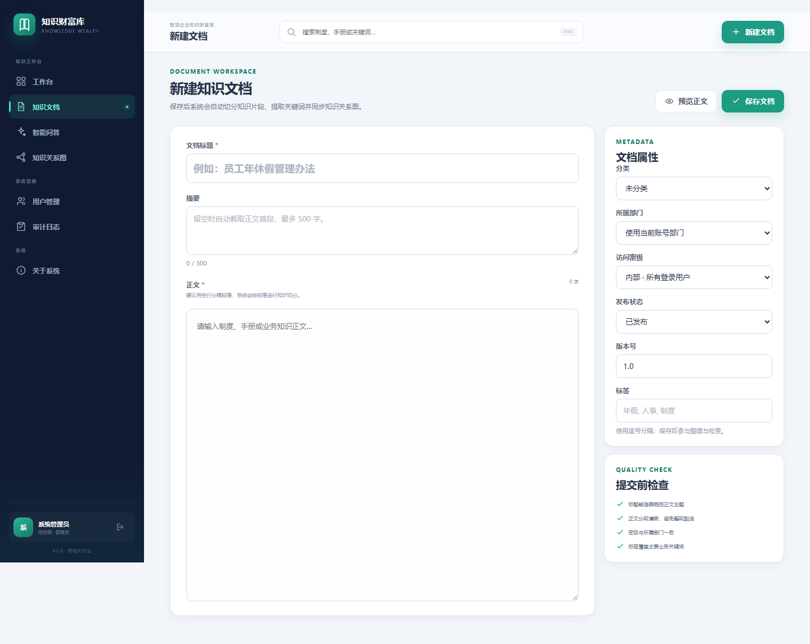

| 项目 | 说明 |
|---|---|
| 对应文件 | `docs/screenshots/05-document-editor.png`；实现：`frontend/src/views/DocumentEditorView.vue` |
| 页面目标 | 新建或编辑文档，并以可视化预览降低录入错误 |
| 主要区域 | 标题、摘要、正文编辑区、字数统计、正文预览开关；右侧分类、部门、访问密级、发布状态、版本号、标签；提交前检查提示 |
| 关键交互 | 切换预览；保存前校验标题和正文；标签按中英文逗号拆分；保存后跳转详情；编辑模式加载原文档并检查 `can_edit` |
| 数据/API | `GET /api/categories`；`POST /api/documents`；`PUT /api/documents/{id}` |
| 权限/异常 | 新建所有登录用户可用；编辑仅作者或管理员；分类不存在/标题正文为空返回 400；保存后自动切分片段和同步图谱 |
| 需求/代码映射 | UR-DOC-04/05；SR-DOC-005/006/007；`DocumentEditorView.vue`、`app/api.py::_apply_document_payload`、`_finalize_document` |

#### 2.2.6 智能问答页

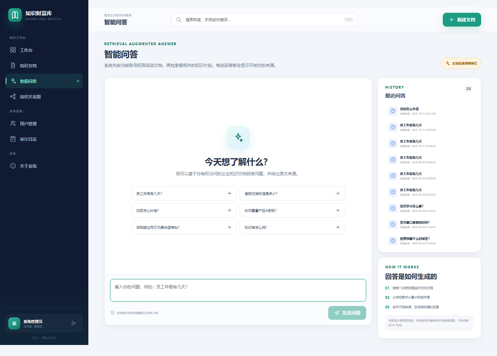

| 项目 | 说明 |
|---|---|
| 对应文件 | `docs/screenshots/06-qa.png`；实现：`frontend/src/views/QaView.vue` |
| 页面目标 | 用自然语言提问，展示带来源和片段的回答，并保留个人问答历史 |
| 主要区域 | 模式能力标签（本地检索摘要/大模型增强）；欢迎区与示例问题；对话区；问题输入框；回答来源卡与片段；右侧最近问答、回答生成说明、历史详情弹窗 |
| 关键交互 | 点击示例问题、提交问题、自动滚动到最新消息、打开历史详情；无 Key 时明确显示本地模式 |
| 数据/API | `GET /api/qa` 获取建议、历史、`llm_enabled`；`POST /api/qa/ask` 返回 `answer/mode/mode_label/sources/fragments/history_id`；`GET /api/qa/history/{id}` 查看来源 |
| 权限/异常 | 仅检索当前用户可访问的已发布片段；普通用户只读本人历史；问题为空 400；无命中显示可理解回答；大模型失败回退本地 |
| 需求/代码映射 | UR-QA-01/02/03/04；SR-QA-001～009；`QaView.vue`、`app/services/rag.py` |
#### 2.2.7 知识关系图

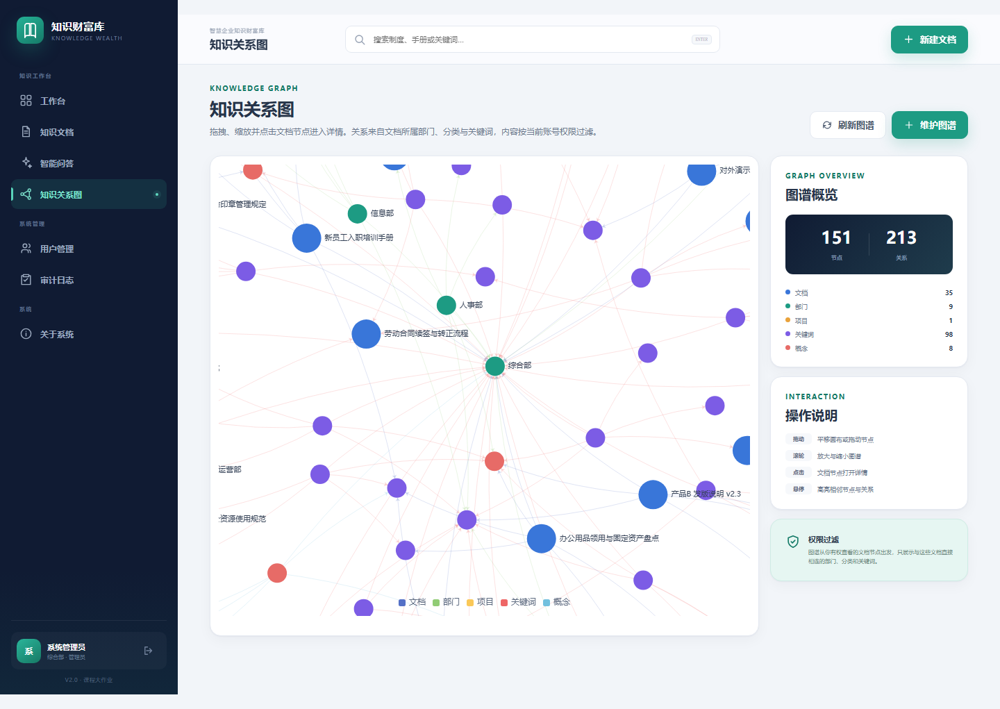

| 项目 | 说明 |
|---|---|
| 对应文件 | `docs/screenshots/07-graph.png`；实现：`frontend/src/views/GraphView.vue` |
| 页面目标 | 通过力导向图呈现文档、部门、关键词、概念之间的可交互关系 |
| 主要区域 | 650px 图谱画布；刷新图谱；管理员“维护图谱”；右侧节点/关系统计、类型颜色图例、交互说明、权限过滤提示；管理员维护弹窗 |
| 关键交互 | 拖动/平移、滚轮缩放、悬停高亮、点击文档节点跳详情；管理员新增节点或边；刷新重新加载 |
| 数据/API | `GET /api/graph` 返回 `nodes/links/categories`；`GET /api/graph/manage`；`POST /api/graph/nodes`；`POST /api/graph/edges` |
| 权限/异常 | 图谱从可见文档节点出发裁剪；普通用户看不到仅由隐藏文档连接的节点；新增维护接口仅管理员，非管理员 403 |
| 需求/代码映射 | UR-KG-01/02；SR-KG-001～005；`GraphView.vue`、`app/services/graph.py` |

#### 2.2.8 用户管理

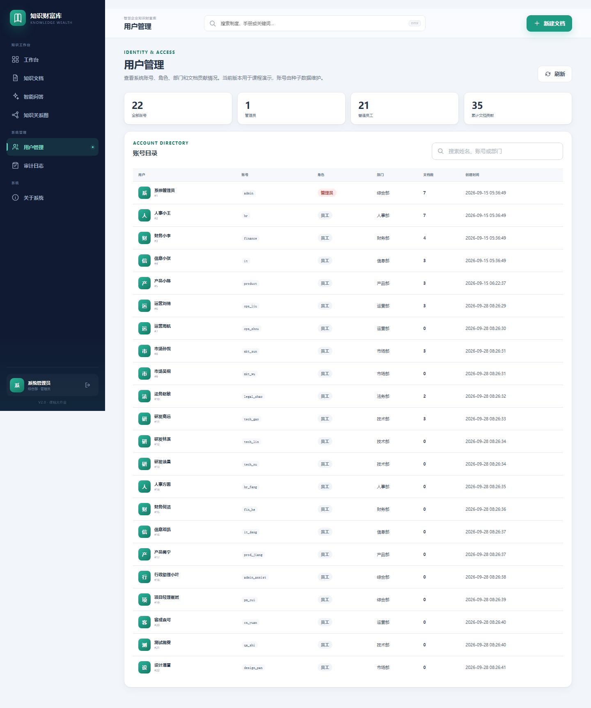

| 项目 | 说明 |
|---|---|
| 对应文件 | `docs/screenshots/08-users.png`；实现：`frontend/src/views/UsersView.vue` |
| 页面目标 | 管理员查看演示账号、角色、部门和文档贡献 |
| 主要区域 | 账号数/管理员数/员工数/累计文档贡献统计；账号目录表；本地搜索框；用户、账号、角色、部门、文档数、创建时间 |
| 关键交互 | 刷新；按姓名、账号或部门即时过滤 |
| 数据/API | `GET /api/admin/users` 返回 `items` 与 `summary` |
| 权限/异常 | 仅管理员；普通员工路由守卫返回工作台；当前版本不支持新增/删除账号，账号由种子数据维护 |
| 需求/代码映射 | UR-AUTH-03；SR-AUTH-004；`UsersView.vue`、`app/api.py::admin_users` |

#### 2.2.9 审计日志

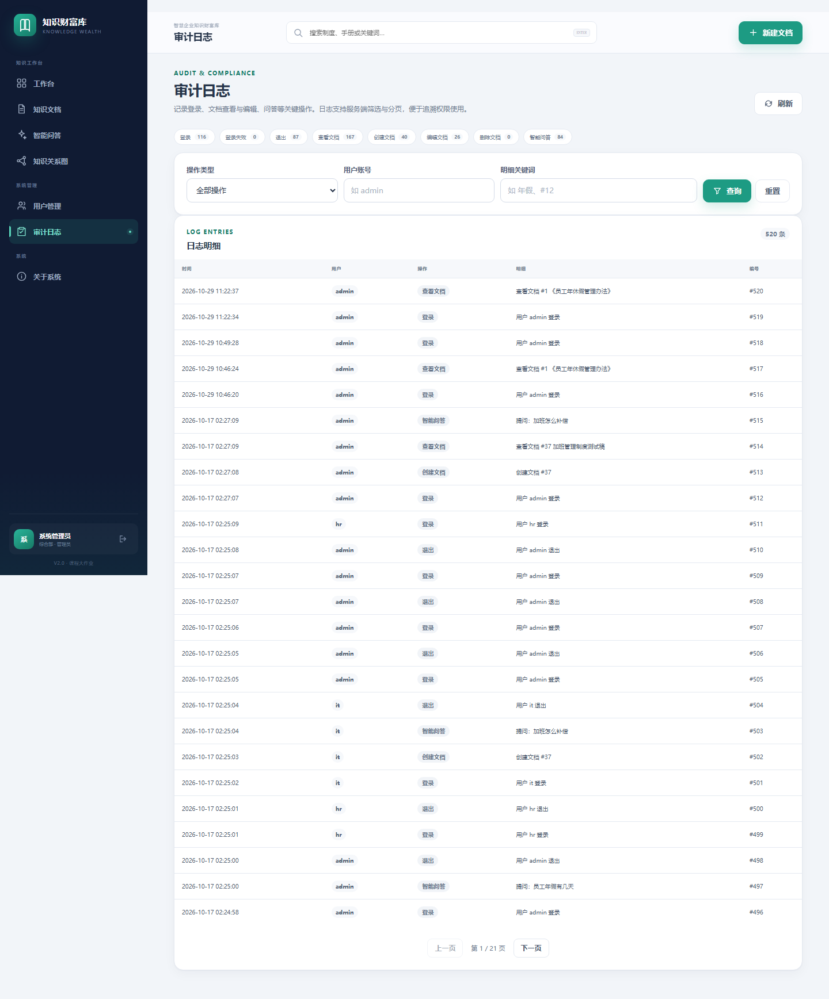

| 项目 | 说明 |
|---|---|
| 对应文件 | `docs/screenshots/09-audits.png`；实现：`frontend/src/views/AuditsView.vue` |
| 页面目标 | 追溯登录、文档查看/编辑、问答等关键操作 |
| 主要区域 | 动作快捷筛选胶囊；用户、明细筛选；日志统计；日志明细表；上一页/下一页；动作中文标签 |
| 关键交互 | 按动作筛选；按用户名/明细模糊筛选；重置；翻页；刷新 |
| 数据/API | `GET /api/admin/audits`，参数 `action/user/detail/page`；后端固定每页 25 条并返回 `pagination/action_stats/actions` |
| 权限/异常 | 仅管理员；非管理员 403；登录失败和未登录失败尝试也进入审计 |
| 需求/代码映射 | UR-AUD-01；SR-AUD-001/002；`AuditsView.vue`、`app/api.py::admin_audits` |

#### 2.2.10 关于系统

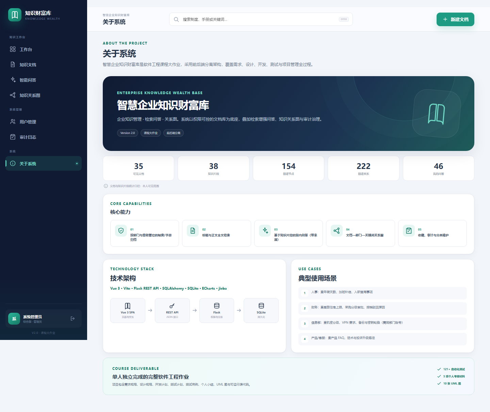

| 项目 | 说明 |
|---|---|
| 对应文件 | `docs/screenshots/10-about.png`；实现：`frontend/src/views/AboutView.vue` |
| 页面目标 | 说明项目定位、版本、技术栈、能力、典型场景和课程交付信息 |
| 主要区域 | 品牌主视觉；版本/课程/前后端分离徽标；可见文档、片段、节点、关系、本人问答统计；核心能力卡；技术架构流程；典型使用场景；课程交付说明 |
| 关键交互 | 页面加载 `GET /api/about`；文档与片段统计随当前权限变化，节点/边为结构统计，问答为本人统计 |
| 数据/API | `GET /api/about` 返回 `app`、`stats`、`scope` |
| 权限/异常 | 仅已登录；未登录由路由守卫跳登录；统计数据不泄露机密规模 |
| 需求/代码映射 | SR-OPS-003；`AboutView.vue`、`app/api.py::about` |

### 2.3 页面原型与需求追踪

| 需求组 | 覆盖页面 | 关键验证点 |
|---|---|---|
| 认证与权限 | 登录、工作台、文档详情/编辑、用户、审计 | 登录会话、角色菜单、机密文档 403、管理员入口 |
| 文档管理 | 工作台、文档列表、详情、编辑 | 新建/查看/编辑/删除、分类/标签/密级/状态、片段数 |
| RAG 问答 | 问答、工作台快捷提问、文档详情“围绕此主题提问” | 来源可追溯、权限内检索、历史与模式提示 |
| 知识图谱 | 图谱、管理员维护弹窗 | 力导向交互、节点类型图例、权限裁剪 |
| 收藏与审计 | 文档列表/详情、工作台、审计 | 收藏切换、审计动作筛选与分页 |
| 运维体验 | 关于、健康检查、页面空状态 | 统计口径、版本信息、错误可读性 |

---

## 3. 用例实现顺序/时序图及说明

### 3.1 用例实现顺序总览

本项目选择“前后端分离”实现，所有业务页面通过 `frontend/src/api/client.js` 发出同源 `/api` 请求，Flask API 返回 JSON。实际实现顺序可以归纳为：

| 顺序 | 用户动作 | 前端处理 | API/服务 | 数据变化 |
|---:|---|---|---|---|
| 1 | 打开系统 | 路由守卫请求 `GET /api/meta`、`GET /api/auth/session` | 应用元信息、会话判定 | 无 |
| 2 | 登录 | 提交登录表单 | `POST /api/auth/login` → 限流 → 密码校验 → 会话 | 新增 login 或 login_failed 审计 |
| 3 | 浏览工作台 | 请求工作台摘要 | `GET /api/dashboard` → 权限过滤文档 | 无 |
| 4 | 检索/查看文档 | 列表与详情请求 | `GET /api/documents`、`GET /api/documents/{id}` | 查看详情写 view_document 审计 |
| 5 | 新建/编辑文档 | 表单保存 | `POST/PUT /api/documents` → 事务 → 片段 → 图谱 → 审计 | documents、knowledge_chunks、graph_*、audit_logs |
| 6 | 提问 | 聊天提交 | `POST /api/qa/ask` → 权限过滤 → 检索 → 生成/摘要 → 历史 → 审计 | qa_history、audit_logs |
| 7 | 浏览图谱 | 加载图谱 | `GET /api/graph` → 可见文档节点裁剪 | 无 |
| 8 | 管理员审计/用户 | 管理页面 | `GET /api/admin/*` | 无 |

### 3.2 登录用例时序图

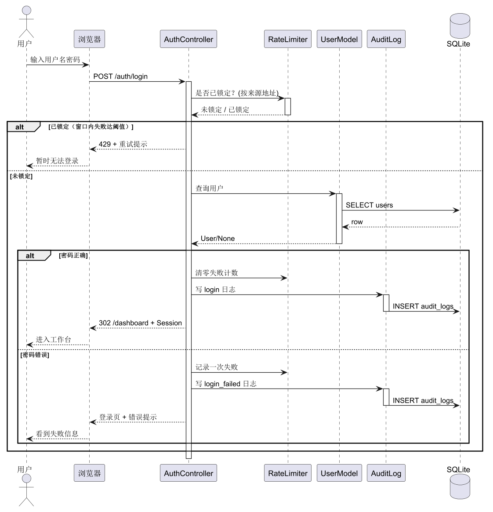

**图源**：[`docs/uml/02-登录时序图.puml`](../uml/02-登录时序图.puml)
**渲染图**：[`docs/uml/rendered/02-登录时序图.png`](../uml/rendered/02-登录时序图.png)

**图例说明**：

| 元素 | 含义 |
|---|---|
| 参与者/对象 | 用户、浏览器、AuthController、RateLimiter、UserModel、AuditLog、SQLite |
| 实线箭头 | 同步调用或数据库请求 |
| 虚线箭头 | 返回结果 |
| 垂直激活条 | 对象处于处理期间 |
| `alt` 组合片段 | 互斥分支：已锁定/未锁定；密码正确/错误 |
| `302 /dashboard + Session` | 传统页面版登录回跳；V2.0 Vue 版对应 `200 + user + 会话 Cookie`，随后由前端路由跳转 |

**关键元素解释**：

1. **RateLimiter 在密码校验之前执行**。锁定期间即使密码正确也不放行，避免爆破者利用“正确密码”探测。
2. **失败与成功都写审计**。成功后写 `login`，失败后写 `login_failed`；未知用户名也记录用户名，便于发现爆破。
3. **服务端负责会话**。前端只保存用户状态到响应式 store；真正的登录态由 Flask-Login 的会话 Cookie 维持。
4. **V2.0 路由对照**：UML 图保留早期页面路由 `/auth/login` 的表述；当前 Vue 实现调用 `POST /api/auth/login`，但控制流、限流、密码校验和审计顺序一致，见 `app/api.py::login`。

**实现对应表**：

| 时序步骤 | 实现位置 | 说明 |
|---|---|---|
| 输入账号密码 | `frontend/src/views/LoginView.vue` | 表单校验和演示账号填充 |
| 发起登录 | `frontend/src/stores/session.js`、`frontend/src/api/client.js` | `credentials: 'include'`，JSON 请求 |
| 锁定检查 | `app/api.py::login`、`app/utils.py::RateLimiter` | 按 `request.remote_addr` 的滑动窗口 |
| 查询用户/密码校验 | `app/models.py::User.check_password` | Werkzeug 带盐慢哈希 |
| 写审计 | `app/models.py::AuditLog` | `login`/`login_failed` |
| 建立会话 | `flask_login.login_user` | `remember` 可延长登录态 |
| 登录回跳 | `frontend/src/router/index.js` | 路由守卫与 `redirect` 查询参数 |

### 3.3 RAG 智能问答时序图

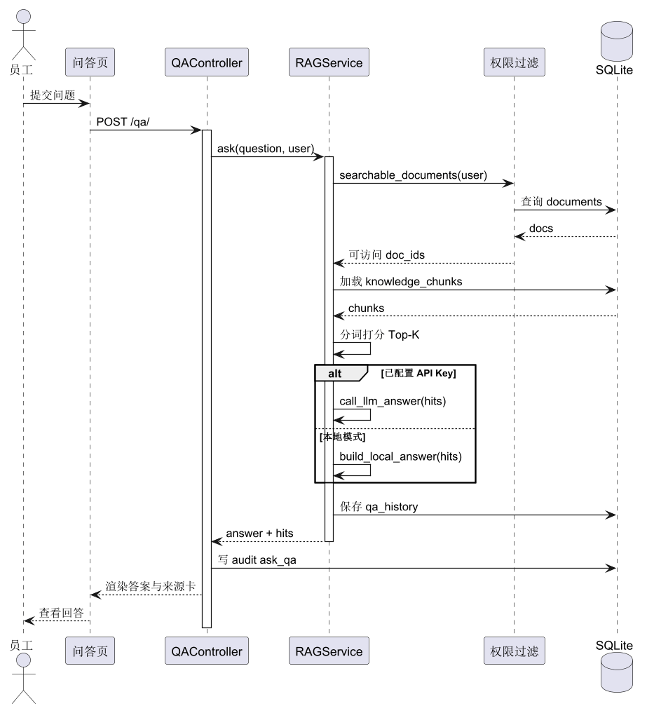

**图源**：[`docs/uml/03-RAG问答时序图.puml`](../uml/03-RAG问答时序图.puml)
**渲染图**：[`docs/uml/rendered/03-RAG问答时序图.png`](../uml/rendered/03-RAG问答时序图.png)

**图例说明**：

| 元素 | 含义 |
|---|---|
| 员工 | 提交自然语言问题的已登录用户 |
| 问答页/QAController | Vue 问答页面与 Flask API 控制器 |
| RAGService | 权限过滤后的片段检索、打分、回答生成与历史保存 |
| 权限过滤 | `searchable_documents()` / `can_view_document()` |
| SQLite | 文档、片段、问答历史与审计持久化 |
| `alt` 分支 | 有 API Key 时调用大模型；无 Key 时本地摘要 |
| `Top-K` | 按相关度排序后最多取配置数量片段，同文档最多 2 个片段 |

**关键元素解释**：

1. **先鉴权、后检索**。`retrieve()` 先计算当前用户可见文档 id 集合，再加载对应 `knowledge_chunks`，从源头上避免越权片段进入上下文。
2. **本地模式是默认可用路径**。`build_local_answer()` 将命中片段整理成摘要式回答，并明确说明“本地检索摘要模式”；没有 Key 不会冒充大模型。
3. **来源可追溯**。返回 `sources`（按文档合并）和 `fragments`（原始片段），每个片段带 `document_id/title/department/score/fragment_no/fragment_total`。
4. **问答历史持久化**。`qa_history` 保存问题、答案、来源 JSON、模式和时间；普通用户只能读取本人记录，管理员可读取全部。
5. **V2.0 路由对照**：UML 图保留早期 `/qa/` 页面路由；当前 Vue 前端调用 `POST /api/qa/ask`，服务端处理流程与图中 `QAController → RAGService → 权限过滤 → SQLite` 一致。

**实现对应表**：

| 时序步骤 | 实现位置 | 说明 |
|---|---|---|
| 提交问题 | `frontend/src/views/QaView.vue` | 输入框/示例问题、loading 与错误提示 |
| 权限过滤 | `app/services/rag.py::searchable_documents` | 只取已发布且可见文档 |
| 加载片段 | `app/services/rag.py::retrieve` | `KnowledgeChunk.document_id.in_(allowed_ids)` |
| 分词与评分 | `_tokenize`、`score_chunk`、`rank_documents` | jieba + 关键词 + 标题命中 + 短语包含 |
| Top-K 去重 | `retrieve` | 同文档最多 2 个片段，默认 `TOP_K=5` |
| 生成回答 | `build_local_answer` / `call_llm_answer` | 本地摘要或 OpenAI 兼容接口 |
| 保存历史 | `QAHistory`、`ask()` | `sources` 保存来源 JSON |
| 写审计 | `app/api.py::ask_question` | `ask_qa` 动作，问题摘要最多 80 字 |
| 前端渲染 | `QaView.vue` | 对话气泡、来源卡、历史详情 |

### 3.4 文档发布活动图

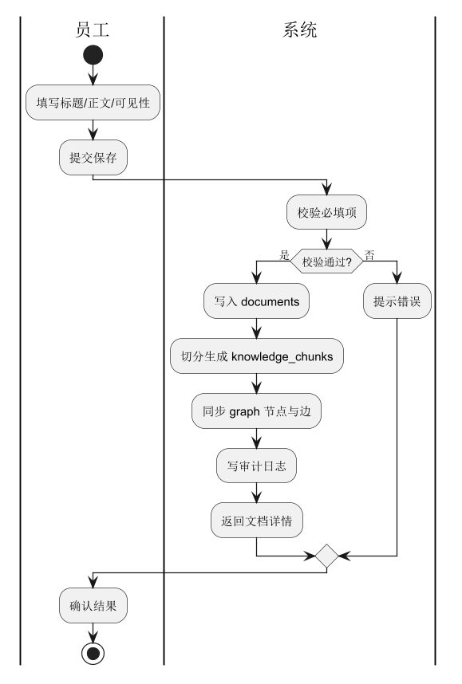

**图源**：[`docs/uml/04-文档发布活动图.puml`](../uml/04-文档发布活动图.puml)
**渲染图**：[`docs/uml/rendered/04-文档发布活动图.png`](../uml/rendered/04-文档发布活动图.png)

**图例说明**：圆点表示开始/结束；圆角矩形表示活动；菱形表示校验分支；泳道区分“员工”和“系统”；箭头表示控制流。

**说明**：员工填写标题、正文、可见性并提交保存后，系统校验必填项；校验失败提示错误，校验通过则写入 `documents`，随后切分生成 `knowledge_chunks`、同步图谱节点与边、写入审计日志，最后返回文档详情。该活动图对应 `app/api.py::_finalize_document()` 的组合流程，与 `app/services/rag.py::rebuild_chunks_for_document()`、`app/services/graph.py::sync_document_graph()` 可以直接对照。

### 3.5 文档状态图

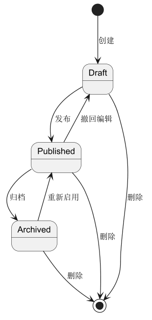

**图源**：[`docs/uml/05-文档状态图.puml`](../uml/05-文档状态图.puml)
**渲染图**：[`docs/uml/rendered/05-文档状态图.png`](../uml/rendered/05-文档状态图.png)

**图例说明**：实心圆为初始状态；圆角矩形为 `Draft/Published/Archived`；箭头为发布、撤回编辑、归档、重新启用、删除等状态迁移；终止圆为删除或销毁。

**说明**：

- `draft`：草稿；列表默认不展示，作者/管理员可打开详情。
- `published`：已发布；进入普通检索和问答范围。
- `archived`：已归档；不再作为普通列表/问答知识源，作者/管理员仍可查看和维护。
- 当前 API 通过 `PUT /api/documents/{id}` 修改 `status` 字段完成状态迁移；`DELETE /api/documents/{id}` 删除记录并移除图谱节点/边。

### 3.6 时序/活动与代码、测试对应

| 用例 | 图 | 主要代码 | 测试关注点 |
|---|---|---|---|
| 登录 | 02-登录时序图 | `app/api.py::login`、`app/blueprints/auth.py`、`app/utils.py::RateLimiter` | 401、429、会话、失败审计、密码哈希 |
| 智能问答 | 03-RAG问答时序图 | `app/api.py::ask_question`、`app/services/rag.py` | 权限过滤、Top-K、来源、模式、历史 |
| 管理文档 | 04-文档发布活动图、05-文档状态图 | `app/api.py::_apply_document_payload`、`_finalize_document` | 必填校验、片段重建、图谱同步、状态可见性 |
| 浏览图谱 | 03 时序图的权限过滤思想 + `GET /api/graph` | `app/api.py::_visible_graph_payload`、`app/services/graph.py` | 不可见文档节点不泄露 |
| 管理/审计 | 02 时序图的审计分支 + 管理 API | `app/api.py::admin_*`、`AuditLog` | 仅管理员、分页、动作筛选 |

---
## 4. 系统/模块类图及说明

### 4.1 领域类图

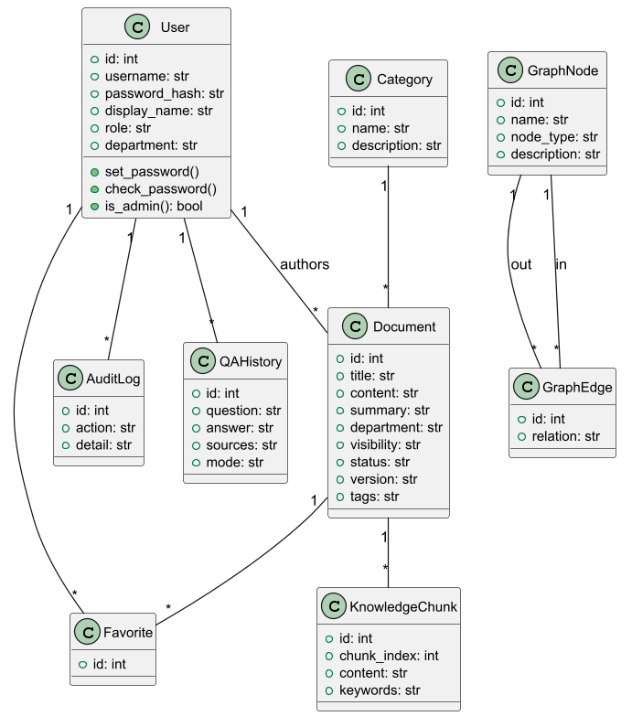

**图源**：[`docs/uml/06-类图.puml`](../uml/06-类图.puml)
**渲染图**：[`docs/uml/rendered/06-类图.png`](../uml/rendered/06-类图.png)

### 4.2 图例与关键元素

| 图元素 | 含义 | 示例 |
|---|---|---|
| `C` 类框 | 类/ORM 实体/服务类 | User、Document、QAHistory |
| 分区 | 类名、属性、方法 | `Document` 的标题、正文、密级等 |
| `+` | 公开属性/方法 | `set_password()`、`check_password()` |
| `-` | 私有属性 | `RateLimiter._events` |
| 实线 | 关联 | User 1—* Document |
| 数字/`*` | 多重性 | 1 个用户可有多篇文档 |
| 注释框 | 约束说明 | 审计 action 取值 |
| `RateLimiter` | 安全基础类 | 进程内滑动窗口限流 |

### 4.3 类职责说明

| 类/模块 | 职责 | 关键字段/方法 | 代码路径 |
|---|---|---|---|
| `User` | 身份、角色、部门、密码哈希、管理员判定 | `id/username/password_hash/display_name/role/department`；`set_password/check_password/is_admin` | `app/models.py` |
| `Category` | 文档分类与说明 | `id/name/description` | `app/models.py` |
| `Document` | 文档主体、摘要、密级、状态、版本、标签、作者/分类关联 | `title/content/summary/department/visibility/status/version/tags/category_id/author_id` | `app/models.py` |
| `KnowledgeChunk` | 文档切分后的检索片段 | `document_id/chunk_index/content/keywords` | `app/models.py` |
| `GraphNode` | 图谱节点（文档/部门/关键词/概念/项目） | `name/node_type/description/document_id` | `app/models.py` |
| `GraphEdge` | 节点之间的有向关系 | `source_id/target_id/relation` | `app/models.py` |
| `Favorite` | 用户收藏关系与唯一约束 | `user_id/document_id/created_at` | `app/models.py` |
| `AuditLog` | 关键操作审计 | `user_id/action/detail/created_at` | `app/models.py` |
| `QAHistory` | 问答历史与来源 JSON | `user_id/question/answer/sources/mode/created_at` | `app/models.py` |
| `RateLimiter` | 按来源 IP 的滑动窗口限流 | `max_attempts/window_seconds`；`record_failure/clear/is_locked/retry_after` | `app/utils.py` |
| `RAG 服务` | 切分、关键词、检索、打分、回答生成 | `chunk_text/extract_keywords/retrieve/ask` | `app/services/rag.py` |
| `图谱服务` | 节点复用、边去重、文档图谱同步、删除清理 | `sync_document_graph/ensure_edge/graph_payload` | `app/services/graph.py` |
| `API 蓝图` | REST 接口、JSON 响应、权限装饰器 | `api_login_required/api_admin_required` | `app/api.py` |

### 4.4 主要关联与多重性

| 关联 | 多重性 | 约束/说明 |
|---|---|---|
| User → Document | 1 : 0..* | `Document.author_id` 可空；作者删除/未知时显示“未知作者” |
| Category → Document | 1 : 0..* | `Document.category_id` 可空；空值表示未分类 |
| Document → KnowledgeChunk | 1 : 0..* | 保存即重建片段，删除文档级联删除片段 |
| User → Favorite | 1 : 0..* | 个人收藏 |
| Document → Favorite | 1 : 0..* | 文档删除级联删除收藏 |
| User → AuditLog | 1 : 0..* | `user_id` 可空，匿名失败尝试可无用户 |
| User → QAHistory | 1 : 0..* | `user_id` 可空；普通用户仅访问本人记录 |
| GraphNode → GraphEdge | 1 : 0..*（出边） | `source_id` 外键 |
| GraphNode → GraphEdge | 1 : 0..*（入边） | `target_id` 外键 |
| Document → GraphNode | 1 : 0..* | `document_id` 可空；文档节点用于图谱权限裁剪 |

### 4.5 系统/模块类视图

为补充领域类图只展示核心实体、未展开前端页面和后端控制器的不足，系统模块关系可由以下两层图说明：

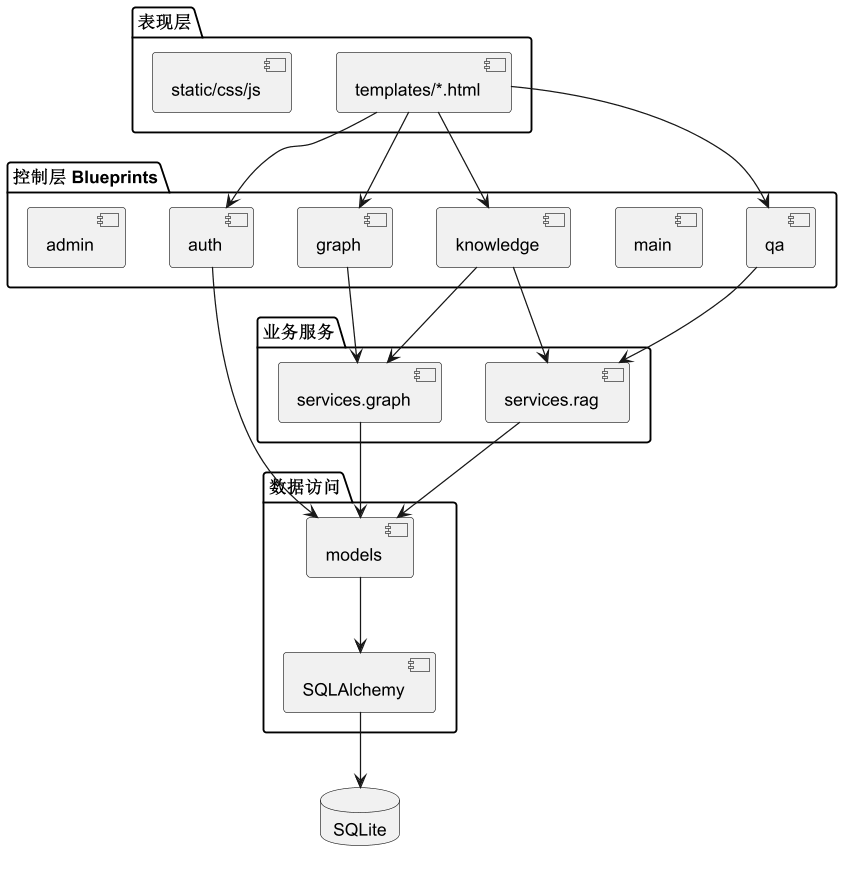

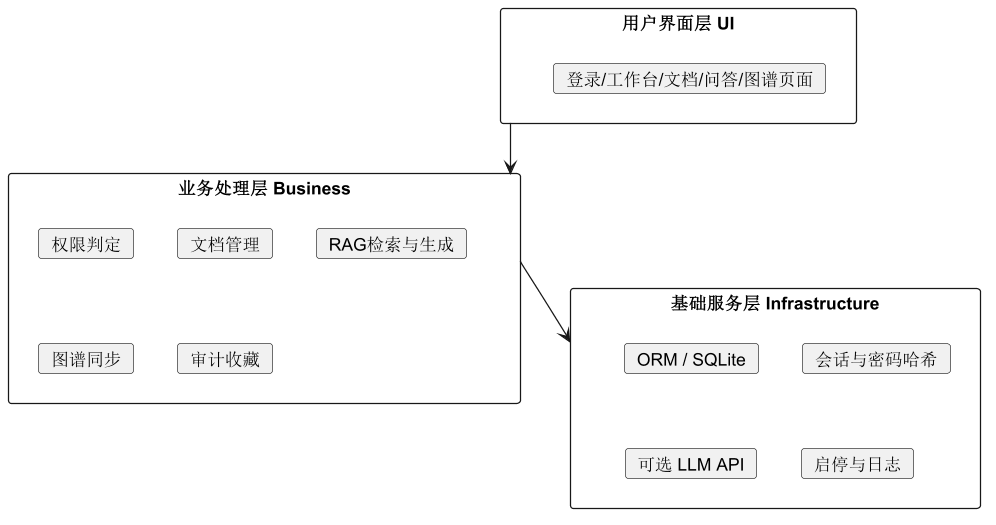

| 层次 | 模块/类 | 主要职责 | 对应实现 |
|---|---|---|---|
| 表现层 | Vue Views、AppShell、PageHeader、BaseChart、EmptyState | 页面路由、布局、图表、空状态、交互反馈 | `frontend/src/views/`、`frontend/src/components/` |
| 接口层 | Flask `api` Blueprint | 统一 `/api`、会话校验、管理员校验、JSON 序列化、错误码 | `app/api.py` |
| 业务服务层 | `rag.py`、`graph.py` | 切分/检索/问答、图谱同步/裁剪 | `app/services/` |
| 数据访问层 | SQLAlchemy ORM 模型 | 表映射、关系、约束、查询 | `app/models.py` |
| 基础设施层 | SQLite、Flask-Login、Werkzeug、jieba、ECharts | 持久化、会话、密码哈希、分词、可视化 | `instance/knowledge.db`、依赖库 |
| 安全横切 | `RateLimiter`、`audit_detail`、`can_view_document` | 限流、审计文案、密级判定 | `app/utils.py`、`app/services/rag.py` |

**构件图图例**：矩形构件表示可替换的软件单元，箭头表示依赖/调用方向；`templates`/`static` 与蓝图属于旧页面兼容层，V2.0 的主界面由 Vue 前端通过 REST API 调用同一业务服务。
**三层架构图图例**：UI 层负责展示，Business 层负责权限、文档、RAG、图谱、审计，Infrastructure 层提供 ORM/SQLite、会话、密码哈希、可选 LLM API 与启停日志。

### 4.6 类图与需求/代码对应

| 需求组 | 主要类/服务 | 关键行为 | 证据 |
|---|---|---|---|
| 认证与权限 | `User`、`RateLimiter`、API 装饰器 | 登录、角色、密码哈希、限流、会话 | `app/models.py`、`app/utils.py`、`app/api.py` |
| 文档管理 | `Document`、`Category`、`KnowledgeChunk` | CRUD、分类、片段重建 | `app/models.py`、`app/services/rag.py` |
| 智能问答 | `QAHistory`、RAG 服务 | 检索、打分、生成、来源、历史 | `app/services/rag.py` |
| 知识图谱 | `GraphNode`、`GraphEdge`、图谱服务 | 同步、去重、裁剪、维护 | `app/services/graph.py` |
| 收藏与审计 | `Favorite`、`AuditLog` | 唯一收藏、关键动作留痕 | `app/models.py`、`app/api.py` |

> 说明：类图以“领域类 + 安全类”为主，是为了让课程评审快速看清业务实体和关系；系统级实现细节通过构件图、三层架构图和本章模块表补足，不把框架内部类全部画入领域类图，避免噪声。

---
## 5. 数据库实体类图及 E-R 图及说明

### 5.1 数据库实体类图（ORM 视角）

ORM 实体类与图 4-1 相同，但这里从数据库映射角度阅读：`User`、`Category`、`Document`、`KnowledgeChunk`、`GraphNode`、`GraphEdge`、`Favorite`、`AuditLog`、`QAHistory` 对应 9 张 SQLite 表；`RateLimiter` 是内存安全类，不建表。主要映射定义在 `app/models.py`，通过 SQLAlchemy `db.Model`、`ForeignKey`、`UniqueConstraint` 建立约束。

### 5.2 E-R 图

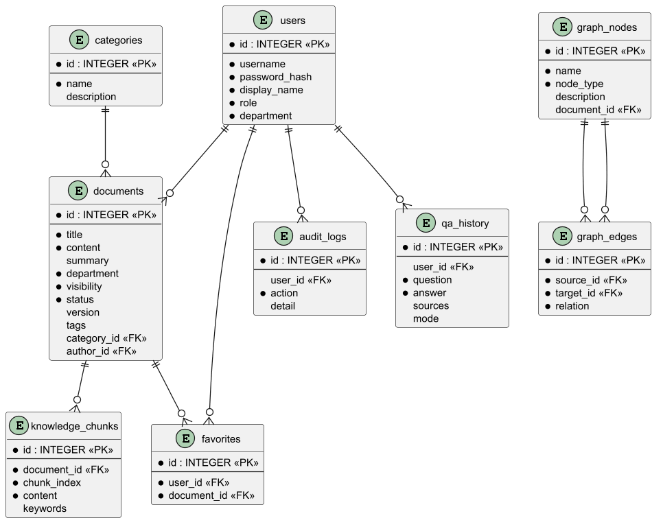

**图源**：[`docs/uml/07-ER图.puml`](../uml/07-ER图.puml)
**渲染图**：[`docs/uml/rendered/07-ER图.png`](../uml/rendered/07-ER图.png)

**图例说明**：

| 元素 | 含义 |
|---|---|
| `E` 实体框 | 数据库实体/表 |
| `PK` | 主键 |
| `FK` | 外键 |
| 普通字段 | 业务属性 |
| 鸟足形连线 | 一对多关系 |
| 竖线/圆圈 | 可选或必选参与 |
| 自关联（graph_nodes） | 节点通过 `graph_edges` 连接其他节点 |

### 5.3 表清单与用途

| 表名 | 实体 | 用途 | 主键 | 关键约束 |
|---|---|---|---|---|
| `users` | 用户 | 账号、角色、部门、密码哈希 | `id` | `username` 唯一、非空、索引 |
| `categories` | 分类 | 文档分类与说明 | `id` | `name` 唯一、非空 |
| `documents` | 文档 | 业务知识正文与元数据 | `id` | 标题/正文/部门/密级/状态非空；作者、分类外键 |
| `knowledge_chunks` | 知识片段 | RAG 检索单元 | `id` | `document_id` 非空、索引；文档删除级联 |
| `graph_nodes` | 图谱节点 | 文档/部门/关键词/概念/项目节点 | `id` | `name` 唯一、非空；可选 `document_id` 外键 |
| `graph_edges` | 图谱边 | 节点之间的关系 | `id` | `source_id/target_id` 外键、非空；同源同目标同关系避免重复 |
| `favorites` | 收藏 | 用户与文档的个人收藏关系 | `id` | `(user_id, document_id)` 唯一 |
| `audit_logs` | 审计日志 | 关键操作留痕 | `id` | `action` 非空；`user_id` 可空 |
| `qa_history` | 问答历史 | 问题、答案、来源、模式 | `id` | `question/answer` 非空；`user_id` 可空 |

### 5.4 关系与基数说明

| 关系 | 基数 | 外键/实现 | 业务含义 |
|---|---|---|---|
| users—documents | 1 : 0..* | `documents.author_id → users.id` | 一个用户可创建多篇文档；作者可空显示未知 |
| categories—documents | 1 : 0..* | `documents.category_id → categories.id` | 一个分类可包含多篇文档；文档可为未分类 |
| documents—knowledge_chunks | 1 : 0..* | `knowledge_chunks.document_id → documents.id` | 一篇文档切分为多个片段；级联删除 |
| users—favorites | 1 : 0..* | `favorites.user_id → users.id` | 用户拥有多个收藏 |
| documents—favorites | 1 : 0..* | `favorites.document_id → documents.id` | 文档可被多个用户收藏；级联删除 |
| users—audit_logs | 1 : 0..* | `audit_logs.user_id → users.id`，可空 | 用户的操作史；匿名失败也可记录 |
| users—qa_history | 1 : 0..* | `qa_history.user_id → users.id`，可空 | 用户的问答历史 |
| graph_nodes—graph_edges（出） | 1 : 0..* | `graph_edges.source_id → graph_nodes.id` | 节点作为关系起点 |
| graph_nodes—graph_edges（入） | 1 : 0..* | `graph_edges.target_id → graph_nodes.id` | 节点作为关系终点 |
| documents—graph_nodes | 1 : 0..* | `graph_nodes.document_id → documents.id`，可空 | 文档节点与业务文档关联，用于权限裁剪 |
### 5.5 数据字典

#### 5.5.1 `users`

| 字段 | 类型 | 可空 | 默认/约束 | 说明 |
|---|---|---|---|---|
| `id` | Integer | 否 | PK | 用户编号 |
| `username` | String(64) | 否 | 唯一、索引 | 登录名 |
| `password_hash` | String(255) | 否 | — | Werkzeug 带盐慢哈希，不保存明文 |
| `display_name` | String(64) | 否 | — | 展示姓名 |
| `role` | String(20) | 否 | 默认 `employee` | `admin`/`employee` |
| `department` | String(64) | 否 | 默认 `综合部` | 部门，决定机密文档同部门可见 |
| `created_at` | DateTime | 是 | 默认本地当前时间 | 创建时间 |

#### 5.5.2 `categories`

| 字段 | 类型 | 可空 | 默认/约束 | 说明 |
|---|---|---|---|---|
| `id` | Integer | 否 | PK | 分类编号 |
| `name` | String(64) | 否 | 唯一 | 分类名称 |
| `description` | String(255) | 是 | 默认空串 | 分类说明 |

#### 5.5.3 `documents`

| 字段 | 类型 | 可空 | 默认/约束 | 说明 |
|---|---|---|---|---|
| `id` | Integer | 否 | PK | 文档编号 |
| `title` | String(200) | 否 | — | 标题 |
| `content` | Text | 否 | 默认空串 | 正文 |
| `summary` | String(500) | 是 | 默认空串 | 摘要，可自动截取 |
| `department` | String(64) | 否 | 默认 `综合部` | 所属部门 |
| `visibility` | String(20) | 否 | 默认 `internal` | `public/internal/secret` |
| `status` | String(20) | 否 | 默认 `published` | `draft/published/archived` |
| `version` | String(20) | 是 | 默认 `1.0` | 版本号 |
| `filename` | String(255) | 是 | 默认空串 | 预留文件名字段 |
| `tags` | String(255) | 是 | 默认空串 | 逗号分隔标签 |
| `category_id` | Integer | 是 | FK → categories.id | 分类 |
| `author_id` | Integer | 是 | FK → users.id | 作者 |
| `created_at` | DateTime | 是 | 默认本地当前时间 | 创建时间 |
| `updated_at` | DateTime | 是 | 默认/更新为本地当前时间 | 更新时间 |

#### 5.5.4 `knowledge_chunks`

| 字段 | 类型 | 可空 | 默认/约束 | 说明 |
|---|---|---|---|---|
| `id` | Integer | 否 | PK | 片段编号 |
| `document_id` | Integer | 否 | FK → documents.id，索引 | 所属文档 |
| `chunk_index` | Integer | 否 | 默认 0 | 文档内片段序号 |
| `content` | Text | 否 | — | 片段正文 |
| `keywords` | String(500) | 是 | 默认空串 | jieba 提取关键词 |

#### 5.5.5 `graph_nodes`

| 字段 | 类型 | 可空 | 默认/约束 | 说明 |
|---|---|---|---|---|
| `id` | Integer | 否 | PK | 节点编号 |
| `name` | String(100) | 否 | 唯一 | 节点名称，如 `文档:员工年休假管理办法` |
| `node_type` | String(40) | 否 | 默认 `concept` | `document/department/project/keyword/concept` |
| `description` | String(255) | 是 | 默认空串 | 节点说明 |
| `document_id` | Integer | 是 | FK → documents.id | 文档节点关联业务文档 |

#### 5.5.6 `graph_edges`

| 字段 | 类型 | 可空 | 默认/约束 | 说明 |
|---|---|---|---|---|
| `id` | Integer | 否 | PK | 边编号 |
| `source_id` | Integer | 否 | FK → graph_nodes.id | 起点节点 |
| `target_id` | Integer | 否 | FK → graph_nodes.id | 终点节点 |
| `relation` | String(64) | 否 | 默认 `关联` | 关系名，如属于/分类为/含有 |

#### 5.5.7 `favorites`

| 字段 | 类型 | 可空 | 默认/约束 | 说明 |
|---|---|---|---|---|
| `id` | Integer | 否 | PK | 收藏编号 |
| `user_id` | Integer | 否 | FK → users.id | 收藏用户 |
| `document_id` | Integer | 否 | FK → documents.id | 被收藏文档 |
| `created_at` | DateTime | 是 | 默认本地当前时间 | 收藏时间 |
| 唯一约束 | — | — | `uq_user_doc_fav(user_id, document_id)` | 防止同一用户重复收藏同一文档 |

#### 5.5.8 `audit_logs`

| 字段 | 类型 | 可空 | 默认/约束 | 说明 |
|---|---|---|---|---|
| `id` | Integer | 否 | PK | 日志编号 |
| `user_id` | Integer | 是 | FK → users.id | 操作用户；未知登录名可为空 |
| `action` | String(64) | 否 | — | 动作代码 |
| `detail` | String(500) | 是 | 默认空串 | 统一中文明细 |
| `created_at` | DateTime | 是 | 默认本地当前时间 | 操作时间 |

**动作代码**：`login`、`login_failed`、`logout`、`view_document`、`create_document`、`edit_document`、`delete_document`、`ask_qa`。

#### 5.5.9 `qa_history`

| 字段 | 类型 | 可空 | 默认/约束 | 说明 |
|---|---|---|---|---|
| `id` | Integer | 否 | PK | 问答编号 |
| `user_id` | Integer | 是 | FK → users.id | 提问用户 |
| `question` | Text | 否 | — | 问题 |
| `answer` | Text | 否 | — | 回答 |
| `sources` | Text | 是 | 默认空串 | JSON 字符串，保存来源文档与分数 |
| `mode` | String(20) | 是 | 默认 `local` | `local/llm` |
| `created_at` | DateTime | 是 | 默认本地当前时间 | 提问时间 |
### 5.6 数据库与代码/API 对应

| 数据库表 | ORM 类 | 主要 API/服务 | 说明 |
|---|---|---|---|
| `users` | `User` | `/api/auth/*`、`/api/admin/users` | 登录、角色、用户列表 |
| `categories` | `Category` | `/api/categories`、文档表单 | 分类维护与文档归类 |
| `documents` | `Document` | `/api/documents*` | 文档 CRUD 与权限过滤 |
| `knowledge_chunks` | `KnowledgeChunk` | `/api/qa/ask`、`/api/documents` 的片段数 | RAG 检索单元 |
| `graph_nodes` | `GraphNode` | `/api/graph*` | 图谱节点与文档关联 |
| `graph_edges` | `GraphEdge` | `/api/graph*` | 图谱关系 |
| `favorites` | `Favorite` | `/api/documents/favorites`、收藏切换 | 个人收藏 |
| `audit_logs` | `AuditLog` | `/api/admin/audits`、各写操作 | 审计追溯 |
| `qa_history` | `QAHistory` | `/api/qa`、`/api/qa/ask`、`/api/qa/history/{id}` | 问答历史与来源 |

### 5.7 数据一致性与查询模式

1. **事务性写入**：文档保存时先 `flush` 获得文档 id，再重建片段、同步图谱，最后统一提交；避免前端看到半写入状态。
2. **删除清理**：删除文档前调用 `remove_document_graph()` 清理图谱节点与边；ORM 级联删除片段与收藏。
3. **权限查询**：列表、问答、图谱都通过 `searchable_documents()` 取可见文档集合，再在服务层进行过滤，避免只依赖前端隐藏。
4. **去重策略**：收藏表唯一约束防重复；图谱边按 `(source_id, target_id, relation)` 查询去重；节点按 `name` 复用。
5. **时间口径**：统一使用 `now_naive()` 的本地时间，API 输出格式为 `YYYY-MM-DD HH:MM:SS`，不携带时区后缀。
6. **JSON 文本字段**：`qa_history.sources` 是 JSON 字符串，读取失败时 API 回退为空数组，保证接口不因历史脏数据崩溃。

### 5.8 数据库设计需求追踪

| 需求 | 数据库支撑 | 代码证据 |
|---|---|---|
| UR-AUTH-04/05/06 | users、audit_logs；密码哈希与限流 | `User.password_hash`、`RateLimiter`、`AuditLog` |
| UR-DOC-01～05 | documents、categories、knowledge_chunks | `Document`、`Category`、`KnowledgeChunk` |
| UR-QA-01～04 | knowledge_chunks、qa_history | `KnowledgeChunk`、`QAHistory`、RAG 服务 |
| UR-KG-01/02 | graph_nodes、graph_edges | `GraphNode`、`GraphEdge`、图谱服务 |
| UR-FAV-01 | favorites | `Favorite` 唯一约束 |
| UR-AUD-01 | audit_logs | `AuditLog`、`admin_audits` |

---

## 6. 个人项目小结

### 6.1 项目完成情况自评

| 维度 | 完成内容 | 自评 |
|---|---|---|
| 需求与范围 | 完成竞品、用户需求、系统需求，明确 V2.0 范围与不做项 | 达到课程要求 |
| 架构与设计 | 完成 Vue + REST API + 服务层 + SQLAlchemy 的分层设计 | 达到课程要求 |
| 功能实现 | 认证、文档、收藏、分类、问答、图谱、用户、审计、关于、健康检查 | 主路径完整 |
| 数据与权限 | 密级、部门、作者、管理员、状态、收藏隔离、问答来源权限 | 重点完成 |
| 工程质量 | 120 个测试函数、API 契约、静态检查配置、启停脚本、UML 本地渲染 | 达到课程要求 |
| 文档完整性 | 10 张 UML、五部分考核材料、REST API 说明书、页面截图引用 | 基本完整 |
| 可演示性 | 本地启动、演示账号、示例问题、错误提示与空状态 | 可演示 |

### 6.2 主要收获

1. **从“能运行”提升到“可追溯”**：文档、片段、问答来源、图谱节点、审计记录之间建立了清晰链路，答辩时可以从页面一路追到数据库和代码。
2. **权限必须落在服务端**：前端隐藏按钮只能改善体验，真正的密级隔离必须由 `searchable_documents()`、`can_view_document()` 和 API 装饰器完成。
3. **单人项目更需要过程管理**：没有团队分工兜底，必须用需求编号、里程碑、测试清单和证据路径约束自己，避免范围膨胀。
4. **本地优先的工程选择**：默认本地摘要问答、SQLite、进程内限流、本地 UML 渲染，降低了外部服务失败对演示的影响。
5. **文档与图不是装饰**：用例图、时序图、类图和 E-R 图分别回答了“谁做什么”“如何调用”“类如何协作”“数据如何落库”，并与代码路径一一对应。

### 6.3 不足与改进方向

| 不足 | 影响 | 改进方向 |
|---|---|---|
| 登录限流为进程内实现 | 多进程/多机部署时计数不共享 | 迁移到 Redis 等共享存储 |
| SQLite 适合演示 | 高并发写入与大规模检索能力有限 | 生产化可迁移 PostgreSQL，并引入向量检索 |
| 关键词检索而非向量语义检索 | 同义表达召回有限 | 引入 embedding/向量库，保留关键词混合检索 |
| 用户管理只读 | 管理员不能在线新增/停用账号 | 增加账号 CRUD、状态与密码重置 |
| 分类删除未开放 | 分类生命周期不完整 | 增加删除前引用检查/迁移策略 |
| 页面截图基线需持续维护 | 页面迭代后截图可能过期 | 固定 `docs/screenshots/01-...` 命名，并把截图更新纳入交付检查 |
| 前端以桌面端为主 | 移动端体验有限 | 增加小屏断点与触控交互专项测试 |

### 6.4 后续计划

1. 将 `docs/screenshots/` 固定为 10 张截图基线，并在交付前逐张核对文件名与页面版本。
2. 增加一条端到端演示脚本，自动验证“登录 → 检索 → 问答 → 图谱 → 审计”。
3. 为 API 补充 OpenAPI 导出，与本文第 08 章保持同步。
4. 在保持 SQLite 演示能力的同时，把 RAG 检索抽象为可替换的检索接口。
5. 继续把用例编号、需求编号、测试编号和代码路径纳入变更检查，避免文档与实现漂移。

---

## 7. 考核材料与证据路径

### 7.1 个人分工与开发任务

| 开发/工程任务 | 本人承担内容 | 完成情况 | 证据路径 |
|---|---|---|---|
| 架构与数据库 | Vue SPA + Flask REST API 分层；9 张表、外键、唯一约束、权限字段 | 完成 | `app/models.py`、`docs/uml/07-ER图.puml`、`docs/course/03-软件设计规格说明书.md` |
| 认证与安全 | 登录/退出、Flask-Login 会话、密码哈希、IP 限流、失败审计、角色装饰器 | 完成 | `app/api.py`、`app/blueprints/auth.py`、`app/utils.py` |
| 前端壳层与路由 | 登录页、AppShell、路由守卫、会话状态、全局样式、错误/空状态 | 完成 | `frontend/src/App.vue`、`frontend/src/components/AppShell.vue`、`frontend/src/router/index.js` |
| 知识文档模块 | 列表、筛选、搜索、分页、详情、新建、编辑、删除、密级/状态控制 | 完成 | `app/api.py`、`frontend/src/views/DocumentsView.vue`、`DocumentDetailView.vue`、`DocumentEditorView.vue` |
| RAG 问答模块 | 文档切分、jieba 关键词、检索评分、Top-K、本地摘要、可选 LLM、来源与历史 | 完成 | `app/services/rag.py`、`frontend/src/views/QaView.vue` |
| 知识图谱模块 | 自动同步文档/部门/分类/关键词节点与边、权限裁剪、ECharts 展示、管理员维护 | 完成 | `app/services/graph.py`、`frontend/src/views/GraphView.vue` |
| 收藏与分类 | 收藏切换、收藏列表、分类列表、管理员新增分类、唯一约束 | 完成 | `app/api.py`、`app/models.py` |
| 用户与审计管理 | 用户目录与文档贡献、审计筛选/分页/动作统计 | 完成 | `app/api.py`、`frontend/src/views/UsersView.vue`、`AuditsView.vue` |
| 关于与健康检查 | 关于页、`/api/about`、`/api/health`、兼容 `/health`、统计口径 | 完成 | `app/api.py`、`app/blueprints/main.py`、`frontend/src/views/AboutView.vue` |
| 测试与质量 | API 契约、权限矩阵、RAG 算法、登录安全、系统回归；测试入口 | 完成测试资产 | `tests/test_*.py`、`run_tests.ps1`、`docs/05-测试报告.md` |
| 工程化与运维 | 启动/停止脚本、Vite 代理、UML 本地渲染、健康检查、环境变量配置 | 完成 | `start.ps1`、`stop.ps1`、`frontend/vite.config.js`、`scripts/render_uml.py` |

### 7.2 文档任务

| 文档任务 | 内容 | 完成情况 | 证据路径 |
|---|---|---|---|
| 竞品调研 | 竞品对比、痛点、差异化定位、范围冻结 | 完成 | `docs/01-竞品调研报告.md` |
| 用户需求 | 用户角色、UR 编号、优先级 | 完成 | `docs/02-用户需求说明书.md` |
| 系统需求 | SR 编号、权限规则、非功能需求、追踪 | 完成 | `docs/03-系统需求说明书.md` |
| 软件设计 | 架构、模块、数据库、API、安全、部署 | 完成 | `docs/04-软件设计说明书.md`、`docs/course/03-软件设计规格说明书.md` |
| UML 图集 | 用例、时序、活动、状态、类、ER、部署、构件、三层架构及本地渲染 | 完成 | `docs/uml/*.puml`、`docs/uml/rendered/*.png` |
| 页面原型与截图 | 10 类业务页面实现与 `01-login`～`10-about` 截图基线 | 完成 | `frontend/src/views/`、`docs/screenshots/` |
| 测试文档 | 测试计划、测试用例、自动化测试与结果说明 | 完成 | `docs/05-测试报告.md`、`docs/course/04-项目测试计划.md`、`docs/course/05-测试用例说明书.md` |
| 项目管理 | 项目计划、里程碑、风险、质量保证、交付清单 | 完成 | `docs/06-项目管理.md`、`docs/course/01-项目开发计划.md`、`docs/course/06-项目总结.md` |
| 个人考核材料 | 5 部分个人材料、分工、完成情况、小结与证据 | 完成 | `docs/course/07-个人项目小结与考核材料.md` |
| REST API 说明书 | 认证、响应/错误码、分页、27 个接口、权限与示例 | 完成 | `docs/course/08-REST-API接口设计说明书.md` |

### 7.3 完成情况汇总

| 交付维度 | 完成情况 | 核对方式 |
|---|---|---|
| 五部分考核材料 | 第 1～5 章全部覆盖，每章有图、图例、关键解释和代码追踪 | 对照本文目录与图片链接 |
| 可运行系统 | Vue 3 前端 + Flask 3 REST API + SQLite 演示数据 | `start.ps1` 启动后访问 `/ui/` |
| 功能主路径 | 登录 → 检索 → 详情 → 新建/编辑 → 问答 → 图谱 → 审计 | 按演示账号手工验证 |
| 权限控制 | 角色、密级、部门、作者、管理员、问答历史归属 | `tests/test_security.py`、`tests/test_login_security.py` |
| 数据一致性 | 文档保存重建片段与图谱；删除清理图谱；收藏唯一约束 | `tests/test_api.py`、`tests/test_rag.py` |
| 自动化测试 | 5 个测试文件、120 个测试函数，独立临时库 | `.\run_tests.ps1` |
| UML 与截图 | 10 张 UML 源/渲染图；10 张页面截图引用 | `docs/uml/`、`docs/screenshots/` |
| 文档一致性 | 需求编号、接口字段、数据库字段和代码路径互相追踪 | 本文第 1～7 章与 08 文档 |
### 7.4 关键证据清单

| 材料 | 路径 | 说明 |
|---|---|---|
| 用例图源/渲染 | `docs/uml/01-用例图.puml`、`docs/uml/rendered/01-用例图.png` | 第 1 章 |
| 登录时序图源/渲染 | `docs/uml/02-登录时序图.puml`、`docs/uml/rendered/02-登录时序图.png` | 第 3 章 |
| RAG 时序图源/渲染 | `docs/uml/03-RAG问答时序图.puml`、`docs/uml/rendered/03-RAG问答时序图.png` | 第 3 章 |
| 文档活动/状态图 | `docs/uml/04-文档发布活动图.puml`、`docs/uml/05-文档状态图.puml` 及对应 PNG | 第 3 章 |
| 类图源/渲染 | `docs/uml/06-类图.puml`、`docs/uml/rendered/06-类图.png` | 第 4、5 章 |
| E-R 图源/渲染 | `docs/uml/07-ER图.puml`、`docs/uml/rendered/07-ER图.png` | 第 5 章 |
| 构件/架构图 | `docs/uml/09-构件图.puml`、`docs/uml/10-三层架构.puml` 及对应 PNG | 第 4 章补充 |
| 页面截图 | `docs/screenshots/01-login.png` 至 `docs/screenshots/10-about.png` | 第 2 章；如命名不同以页面关键词通配核对 |
| API 实现 | `app/api.py` | 27 个主要 REST API 方法/路径 |
| ORM 模型 | `app/models.py` | 9 张表与关系约束 |
| RAG 服务 | `app/services/rag.py` | 切分、分词、检索、回答、来源 |
| 图谱服务 | `app/services/graph.py` | 节点、边、同步、裁剪 |
| 前端 API 客户端 | `frontend/src/api/client.js` | 同源 `/api`、JSON、`credentials: include` |
| 自动化测试 | `tests/test_api.py`、`test_security.py`、`test_rag.py`、`test_login_security.py`、`test_system.py` | 120 个测试函数 |
| 启动与测试 | `start.ps1`、`stop.ps1`、`run_tests.ps1`、`run.py` | 可复现实验/演示 |
| 需求追踪 | `docs/02-用户需求说明书.md`、`docs/03-系统需求说明书.md` | UR/SR 编号 |
| 项目管理 | `docs/06-项目管理.md` | 角色、时间盒、风险、质量 |

### 7.5 提交前检查清单

- [ ] 5 部分标题和顺序与学校要求一致（本文第 1～5 章）。
- [ ] 5 部分均有图引用：第 1 章 `01-用例图`；第 2 章 `01-login`～`10-about`；第 3 章 `02/03/04/05`；第 4 章 `06/09/10`；第 5 章 `06/07`。
- [ ] `docs/screenshots/` 中 10 张截图可打开，文件命名与第 2 章一致或在文中保留通配说明。
- [ ] `docs/uml/rendered/` 中所有 PNG 可打开，中文未出现方框乱码。
- [ ] `docs/course/08-REST-API接口设计说明书.md` 与 `app/api.py` 无字段漂移。
- [ ] `python -m pytest` 或 `.\run_tests.ps1` 在独立测试库上执行通过。
- [ ] 演示账号可登录，主路径“检索 → 问答 → 图谱 → 审计”可复现。
- [ ] 不修改代码或其他文件，仅提交本文件、API 文档及已约定的截图/图集材料。

---

## 8. 结语

本项目虽然是单人独立完成，但按完整的软件工程过程进行了需求、设计、实现、测试、文档和项目管理闭环。V2.0 的实现重点不是堆叠页面，而是把 **文档权限、可追溯问答、可视化图谱、审计治理** 串成一条可验证的链路。本文给出的五部分材料、图引用、代码路径和测试证据，既用于课程考核，也作为后续维护和答辩说明的依据。

*文档结束 · 2026-10-29 · V2.0*
