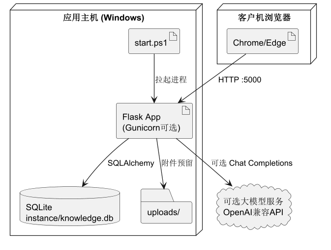

# UML 图目录说明

本目录为 **PlantUML** 源文件，覆盖本系统的用例图、时序图、活动图、状态图、类图、ER 图、部署图、构件图与三层架构图，共 10 张。

## 文件列表与渲染图

| 文件 | 图类型 | 渲染图 |
|------|--------|--------|
| `01-用例图.puml` | 用例图 |  |
| `02-登录时序图.puml` | 时序图 |  |
| `03-RAG问答时序图.puml` | 时序图 |  |
| `04-文档发布活动图.puml` | 活动图（含水道） |  |
| `05-文档状态图.puml` | 状态图 |  |
| `06-类图.puml` | 类图 |  |
| `07-ER图.puml` | E-R 图 |  |
| `08-部署图.puml` | 部署图 |  |
| `09-构件图.puml` | 构件图 |  |
| `10-三层架构.puml` | 三层架构说明图 |  |

## 如何渲染

渲染好的 PNG / SVG 已放在 [`rendered/`](rendered/)，由项目脚本本地离线生成（中文正常显示）：

```powershell
# 首次使用：准备中文字体、PlantUML jar 与自带 JRE 的 Python 包
.\.venv\Scripts\python.exe scripts\setup_uml.py

# 渲染全部图（svg + png）
.\.venv\Scripts\python.exe scripts\render_uml.py

# 仅校验语法是否可被 PlantUML 解析
.\.venv\Scripts\python.exe scripts\render_uml.py --check
```

> 说明：**不建议**用 PlantText / kroki.io 等在线服务渲染本目录的图——这些服务器的
> PlantUML 没有中文字体，所有中文标签会变成空白方框。本项目因此采用本地渲染。
>
> 若手工处理，也可用 VS Code PlantUML 插件（需为本机指定中文字体，如 Noto Sans SC）
> 或 ProcessOn 导入。

## 建议阅读顺序

用例 → 登录时序 → RAG 时序 → 活动 → 状态 → 类图 → ER → 三层架构 → 构件 → 部署
