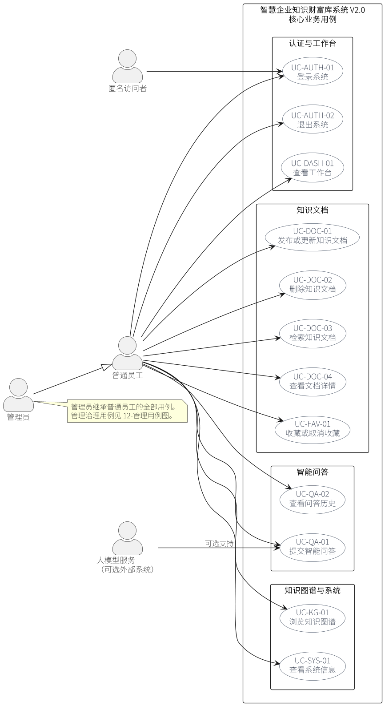
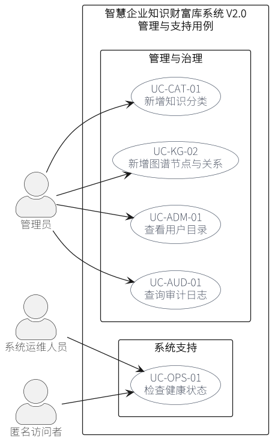
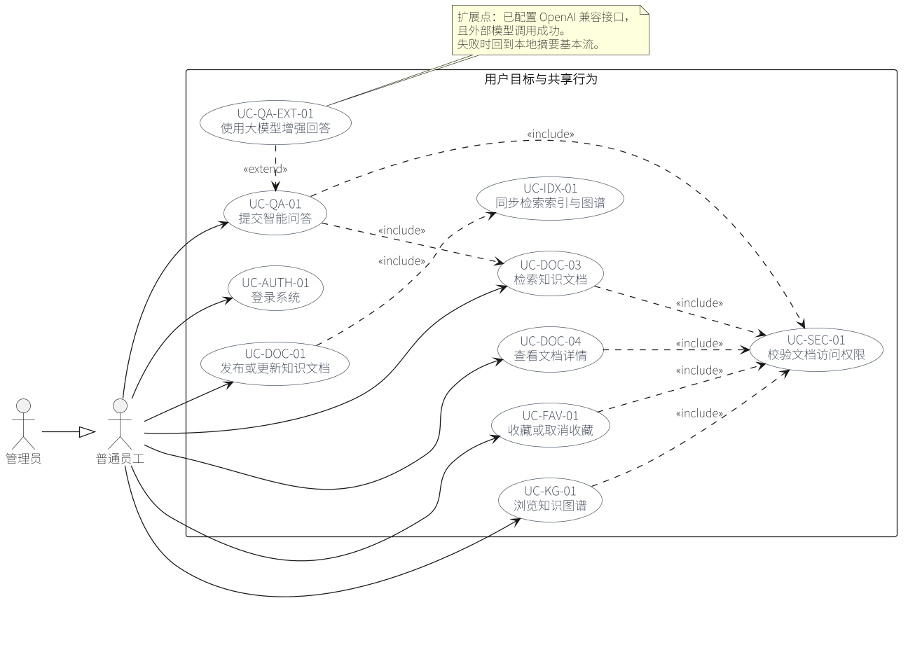

# 智慧企业知识财富库系统——用例模型

| 项目 | 内容 |
|---|---|
| 模型版本 | V1.0 |
| 适用系统 | 智慧企业知识财富库系统 V2.0 |
| 建模依据 | 当前 Flask/Vue 实现、`docs/short/01-项目需求规格.md`、REST API、pytest 用例 |
| 模型范围 | 已实现且可验收的 17 个用户目标用例，以及 3 个共享/扩展用例 |
| 图形工具 | PlantUML 源文件，渲染为 PNG/SVG |

## 1. 建模目的与系统边界

本模型不是功能菜单清单，而是从参与者目标出发描述系统行为。每个用户目标都说明参与者、前置条件、基本事件流、备选事件流、后置条件、业务规则和验收依据。

系统边界内包括：

- 登录、退出和角色权限；
- 工作台、知识文档发布、更新、删除、检索和查看；
- 文档收藏与问答历史；
- 权限范围内的检索增强问答；
- 知识图谱浏览；
- 分类、图谱、用户目录和审计治理；
- 系统信息和健康检查。

系统边界外包括：

- SSO、组织架构同步和细粒度 RBAC；
- 附件上传与解析、版本快照回滚、审核发布流；
- 向量数据库、模型训练和外部消息通知；
- 用户新增、编辑、删除和密码管理；
- 分类、图谱节点与关系的编辑和删除。

未实现能力不能为了“图好看”画进用例图，本模型以当前代码可执行为准。

## 2. 参与者模型

| 参与者 | 类型 | 目标与权限 |
|---|---|---|
| 匿名访问者 | 主要参与者 | 登录系统、访问健康检查等公开入口，不能访问业务数据 |
| 普通员工 | 主要参与者 | 查看权限内文档、检索、问答、收藏、发布本人文档、维护本人文档 |
| 管理员 | 主要参与者 | 继承普通员工全部能力，并可查看全部文档、用户目录、审计日志，管理分类和图谱 |
| 系统运维人员 | 支持参与者 | 通过健康检查判断应用和数据库是否可用 |
| 大模型服务 | 外部支持参与者 | 在配置 OpenAI 兼容接口时参与生成增强答案，不是系统内部对象 |

“文档作者”不是独立角色，而是员工与具体文档之间的所有权关系。普通员工只能编辑或删除本人创建的文档；管理员可以编辑或删除任意文档。

管理员与普通员工之间是参与者泛化关系：

```text
管理员 ——▷ 普通员工
```

管理员继承普通员工对登录、文档、问答、图谱等用例的参与能力，不需要在图中重复连接所有公共用例。

## 3. 系统用例图





PlantUML 源文件：[`../uml/01-用例图.puml`](../uml/01-用例图.puml)、[`../uml/12-管理用例图.puml`](../uml/12-管理用例图.puml)

## 4. 用例清单

| 编号 | 用例 | 主要参与者 | 用户目标 | 优先级 | 需求 |
|---|---|---|---|---|---|
| UC-AUTH-01 | 登录系统 | 匿名访问者、员工、管理员 | 建立可信会话并进入业务系统 | 高 | FR-01、FR-02 |
| UC-AUTH-02 | 退出系统 | 员工、管理员 | 结束会话并留下退出记录 | 高 | FR-01 |
| UC-DASH-01 | 查看工作台 | 员工、管理员 | 查看本人可见范围内的知识运营概况 | 中 | FR-11 |
| UC-DOC-01 | 发布或更新知识文档 | 员工、管理员 | 将知识写入系统并形成可检索内容 | 高 | FR-05 |
| UC-DOC-02 | 删除知识文档 | 文档作者、管理员 | 移除失效文档及其关联数据 | 中 | FR-05 |
| UC-DOC-03 | 检索知识文档 | 员工、管理员 | 在权限范围内找到相关文档 | 高 | FR-04、FR-06 |
| UC-DOC-04 | 查看文档详情 | 员工、管理员 | 阅读正文、来源和相关推荐 | 高 | FR-05、FR-06 |
| UC-FAV-01 | 收藏或取消收藏 | 员工、管理员 | 保存常用文档以便再次访问 | 中 | FR-05 |
| UC-QA-01 | 提交智能问答 | 员工、管理员、大模型服务 | 用自然语言获得带来源的答案 | 高 | FR-07、FR-08 |
| UC-QA-02 | 查看问答历史 | 员工、管理员 | 回看本人问题、答案和来源 | 中 | FR-08 |
| UC-KG-01 | 浏览知识图谱 | 员工、管理员 | 从关系视角探索权限内知识 | 中 | FR-09、FR-06 |
| UC-CAT-01 | 新增知识分类 | 管理员 | 建立文档分类维度 | 低 | FR-12 |
| UC-KG-02 | 新增图谱节点与关系 | 管理员 | 补充知识实体和关联关系 | 中 | FR-10 |
| UC-ADM-01 | 查看用户目录 | 管理员 | 查看用户、部门和文档贡献统计 | 中 | FR-12 |
| UC-AUD-01 | 查询审计日志 | 管理员 | 追踪登录、文档和问答行为 | 高 | FR-13 |
| UC-SYS-01 | 查看系统信息 | 员工、管理员 | 了解系统能力、技术栈和本人范围统计 | 低 | FR-14、FR-15 |
| UC-OPS-01 | 检查健康状态 | 运维人员、匿名访问者 | 判断数据库连接和应用运行状态 | 高 | FR-14 |

## 5. 全局业务规则

| 规则 | 内容 |
|---|---|
| BR-01 | 所有业务用例都要求服务端会话有效；前端隐藏菜单不能代替后端鉴权。 |
| BR-02 | 未登录访问业务 API 返回 401；已登录但角色或所有权不满足返回 403。 |
| BR-03 | 文档密级分为 `public`、`internal`、`secret`；机密文档仅管理员、同部门员工或作者可见。 |
| BR-04 | 普通检索、问答候选集和图谱只纳入已发布文档；作者或管理员可绕过发布状态直接查看草稿/归档详情。 |
| BR-05 | 文档发布或更新成功后必须重建知识片段并同步图谱，否则文档存在但不可检索。 |
| BR-06 | 删除文档必须同步清理图谱节点和关系，避免残留孤点。 |
| BR-07 | 收藏、问答历史和图谱展示仍要执行可见性过滤，不能仅凭记录存在就返回内容。 |
| BR-08 | 问答回答必须附带来源；没有命中时明确说明，不伪造答案。 |
| BR-09 | 外部模型调用失败时回退本地摘要，并如实标记 `local` 模式。 |
| BR-10 | 登录、登录失败、退出、查看文档、创建/编辑/删除文档和问答写入审计日志。 |

## 6. 用例关系模型



PlantUML 源文件：[`../uml/11-用例关系图.puml`](../uml/11-用例关系图.puml)

| 关系 | 源 | 目标 | 说明 |
|---|---|---|---|
| 参与者泛化 | 管理员 | 普通员工 | 管理员继承全部普通员工能力 |
| `<<include>>` | UC-QA-01 提交智能问答 | UC-DOC-03 检索知识文档 | 问答必须先执行权限内检索 |
| `<<include>>` | UC-QA-01 提交智能问答 | UC-SEC-01 校验文档访问权限 | 问答候选集必须先做权限过滤 |
| `<<include>>` | UC-DOC-03 检索知识文档 | UC-SEC-01 校验文档访问权限 | 列表、筛选和检索共用可见性规则 |
| `<<include>>` | UC-DOC-04 查看文档详情 | UC-SEC-01 校验文档访问权限 | 查看正文前再次鉴权 |
| `<<include>>` | UC-FAV-01 收藏或取消收藏 | UC-SEC-01 校验文档访问权限 | 不可收藏无权查看的文档 |
| `<<include>>` | UC-KG-01 浏览知识图谱 | UC-SEC-01 校验文档访问权限 | 图谱节点和边按可见文档裁剪 |
| `<<include>>` | UC-DOC-01 发布或更新知识文档 | UC-IDX-01 同步检索索引与图谱 | 保存后重建片段、索引和关系 |
| `<<extend>>` | UC-QA-EXT-01 使用大模型增强回答 | UC-QA-01 提交智能问答 | 仅在配置模型且调用成功时扩展基本流 |

## 7. 用例详细描述

### 7.1 UC-AUTH-01 登录系统

- **主要参与者**：匿名访问者、普通员工、管理员。
- **目标**：校验身份，建立会话，并记录成功或失败审计。
- **前置条件**：系统运行且数据库可访问；用户拥有合法账号。
- **基本事件流**：提交用户名和密码 → 检查来源地址是否被限流 → 查询用户 → 校验密码 → 清除失败计数并建立会话 → 写入 `login` 审计 → 跳转安全站内地址。
- **备选事件流**：
  - 用户名或密码错误：提示统一错误信息，记录 `login_failed`，不泄露账号是否存在。
  - 失败次数达到阈值：返回 429，暂时拒绝登录，即使密码正确也不放行。
  - 回跳地址指向站外：拒绝该地址，回到默认工作台。
- **后置条件**：成功时存在有效会话；失败时不建立会话，并保留审计记录。
- **关联**：FR-01、FR-02；`POST /api/auth/login`；[完整描述](./UC-登录.md)。

### 7.2 UC-AUTH-02 退出系统

- **主要参与者**：普通员工、管理员。
- **目标**：结束当前会话，防止继续访问受保护接口。
- **前置条件**：用户已登录。
- **基本事件流**：用户选择退出 → 系统写入 `logout` 审计 → 清除登录会话 → 返回登录页。
- **备选事件流**：会话已过期时再次退出，直接返回登录页，不建立新会话。
- **后置条件**：受保护接口再次访问返回 401。
- **关联**：FR-01；`POST /api/auth/logout`。

### 7.3 UC-DASH-01 查看工作台

- **主要参与者**：普通员工、管理员。
- **目标**：查看权限范围内的文档、收藏、问答和图谱概况。
- **前置条件**：用户已登录。
- **基本事件流**：进入工作台 → 系统计算可见文档数、收藏数、问答数 → 汇总部门/分类分布 → 返回最近文档和最近问答 → 管理员额外返回最近审计记录。
- **备选事件流**：没有文档或问答时返回空数组，并展示空状态；不能显示其他部门机密文档的统计。
- **后置条件**：仅返回当前用户可见数据。
- **关联**：FR-11、FR-06；`GET /api/dashboard`。

### 7.4 UC-DOC-01 发布或更新知识文档

- **主要参与者**：普通员工、管理员。
- **目标**：创建或修改一篇可供检索的知识文档。
- **前置条件**：用户已登录；更新时当前用户是作者或管理员。
- **基本事件流**：打开编辑表单 → 填写标题、正文、摘要、部门、密级、状态、版本、标签和分类 → 校验必填项 → 保存文档 → 重建知识片段 → 同步图谱 → 写入 `create_document` 或 `edit_document` 审计 → 返回文档。
- **备选事件流**：
  - 标题或正文为空：返回 400，不保存。
  - 非作者编辑他人员工文档：返回 403。
  - 分类不存在或参数非法：回退到默认值或返回参数错误，不产生半完成数据。
  - 标签为空：允许保存，系统可从正文关键词补充。
- **后置条件**：已发布文档进入权限内检索和问答候选集；草稿和归档不进入普通检索。
- **关联**：FR-05；`POST /api/documents`、`PUT /api/documents/<id>`；[完整描述](./UC-管理知识文档.md)。

### 7.5 UC-DOC-02 删除知识文档

- **主要参与者**：文档作者、管理员。
- **目标**：删除失效文档及其关联数据。
- **前置条件**：用户已登录；当前用户是作者或管理员。
- **基本事件流**：选择文档 → 确认删除 → 系统校验所有权 → 清理图谱节点和关系 → 删除文档 → 写入 `delete_document` 审计 → 返回成功。
- **备选事件流**：文档不存在返回 404；当前用户不是作者且不是管理员返回 403。
- **后置条件**：文档、收藏关联和图谱关联不再可访问。
- **关联**：FR-05；`DELETE /api/documents/<id>`。

### 7.6 UC-DOC-03 检索知识文档

- **主要参与者**：普通员工、管理员。
- **目标**：在权限范围内按关键词和属性筛选文档。
- **前置条件**：用户已登录。
- **基本事件流**：进入文档列表 → 输入关键词或选择分类、部门、密级、排序 → 系统先按可见性筛选已发布文档 → 对标题、标签、摘要和正文打分 → 分页返回结果和分类筛选项。
- **备选事件流**：无命中时返回空列表；页码越界时收敛到有效页；异部门员工请求机密文档时该文档不进入候选集。
- **后置条件**：返回结果全部满足当前用户权限。
- **关联**：FR-04、FR-06；`GET /api/documents`。

### 7.7 UC-DOC-04 查看文档详情

- **主要参与者**：普通员工、管理员。
- **目标**：阅读文档正文、密级、作者、版本、来源和相关推荐。
- **前置条件**：用户已登录。
- **基本事件流**：选择文档 → 校验文档是否存在和是否可见 → 校验草稿/归档状态 → 返回正文、元数据、收藏状态和 `can_edit` → 记录 `view_document` 审计（短时间内去重）→ 展示相关推荐。
- **备选事件流**：文档不存在返回 404；无权查看返回 403；未发布文档仅作者或管理员可查看。
- **后置条件**：用户获得可核对的文档内容，系统留下查看记录。
- **关联**：FR-05、FR-06；`GET /api/documents/<id>`。

### 7.8 UC-FAV-01 收藏或取消收藏

- **主要参与者**：普通员工、管理员。
- **目标**：将常用文档加入或个人收藏列表，或取消收藏。
- **前置条件**：用户已登录且有权查看该文档。
- **基本事件流**：选择收藏按钮 → 系统校验可见性 → 查询当前用户对该文档的收藏记录 → 无记录则新增，有记录则删除 → 返回最新收藏状态。
- **备选事件流**：文档不存在返回 404；无权查看返回 403；取消不存在的收藏按幂等结果处理。
- **后置条件**：收藏关系与当前用户绑定，不影响其他用户。
- **关联**：FR-05；`POST /api/documents/<id>/favorite`。

### 7.9 UC-QA-01 提交智能问答

- **主要参与者**：普通员工、管理员；支持参与者：大模型服务。
- **目标**：在权限范围内获得带来源的答案。
- **前置条件**：用户已登录；知识库存在已发布文档和知识片段。
- **基本事件流**：输入问题 → 校验非空 → 先按权限筛选候选文档 → 对知识片段分词和打分 → 选择 Top-K 来源 → 未配置模型时生成可解释的本地摘要 → 返回答案、来源、模式和问答记录。
- **备选事件流**：
  - 无命中：明确说明权限范围内没有足够依据，不伪造答案。
  - 已配置模型且调用成功：执行扩展用例 UC-QA-EXT-01。
  - 模型超时或失败：回退本地摘要，标记为 `local`。
  - 问题为空：返回 400。
- **后置条件**：保存问答历史，并写入 `ask_qa` 审计。
- **关联**：FR-07、FR-08；`POST /api/qa/ask`；[完整描述](./UC-智能问答.md)。

### 7.10 UC-QA-02 查看问答历史

- **主要参与者**：普通员工、管理员。
- **目标**：回看本人提过的问题、答案、来源和生成模式。
- **前置条件**：用户已登录。
- **基本事件流**：进入问答页 → 系统按最近时间读取本人记录 → 对规范化后相同的问题去重 → 返回最近问题和历史列表 → 打开单条记录时返回来源详情。
- **备选事件流**：历史为空时返回空状态；查看他人员工历史返回 403；管理员可查看单条他人记录详情。
- **后置条件**：不修改历史内容。
- **关联**：FR-08；`GET /api/qa`、`GET /api/qa/history/<id>`。

### 7.11 UC-KG-01 浏览知识图谱

- **主要参与者**：普通员工、管理员。
- **目标**：以节点和关系图探索权限内文档、部门、分类、关键词和概念。
- **前置条件**：用户已登录；系统中存在可见文档或图谱节点。
- **基本事件流**：打开图谱页 → 获取全部图谱 → 以当前用户可见文档节点为起点裁剪节点和边 → 返回分类颜色和关系数据 → 用户拖拽、缩放或点击文档节点进入详情。
- **备选事件流**：无可显示节点时展示空状态；机密文档节点不进入普通员工可见范围；无权文档的边不返回。
- **后置条件**：未泄露任何越权节点名称或关系。
- **关联**：FR-09、FR-06；`GET /api/graph`。

### 7.12 UC-CAT-01 新增知识分类

- **主要参与者**：管理员。
- **目标**：建立新的文档分类。
- **前置条件**：管理员已登录。
- **基本事件流**：填写分类名称和说明 → 校验名称非空 → 校验名称唯一 → 保存分类 → 返回分类信息。
- **备选事件流**：名称为空返回 400；名称重复返回 400；普通员工调用返回 403。
- **后置条件**：分类可被文档编辑页选择。
- **关联**：FR-12；`POST /api/categories`。

### 7.13 UC-KG-02 新增图谱节点与关系

- **主要参与者**：管理员。
- **目标**：补充知识实体和实体间关系。
- **前置条件**：管理员已登录。
- **基本事件流**：打开图谱管理 → 选择节点类型 → 输入名称和说明 → 保存节点；或输入起点、终点和关系名 → 保存关系 → 系统复用同名节点或创建新节点。
- **备选事件流**：节点名称或关系端点为空返回 400；普通员工返回 403；同名节点按复用处理，不重复创建。
- **后置条件**：新增节点或边进入图谱数据；当前功能仅支持新增，不提供编辑和删除。
- **关联**：FR-10；`GET /api/graph/manage`、`POST /api/graph/nodes`、`POST /api/graph/edges`。

### 7.14 UC-ADM-01 查看用户目录

- **主要参与者**：管理员。
- **目标**：查看用户、角色、部门和文档贡献统计。
- **前置条件**：管理员已登录。
- **基本事件流**：打开用户目录 → 系统读取用户列表 → 统计每个用户的文档数 → 汇总总用户、管理员和员工数量 → 返回列表。
- **备选事件流**：普通员工调用返回 403；用户无文档时贡献数为 0。
- **后置条件**：不修改用户数据。
- **关联**：FR-12；`GET /api/admin/users`。

### 7.15 UC-AUD-01 查询审计日志

- **主要参与者**：管理员。
- **目标**：按动作、用户和明细追踪关键行为。
- **前置条件**：管理员已登录。
- **基本事件流**：打开审计页 → 选择动作类型、输入用户名或明细关键词 → 系统在服务端筛选 → 按时间倒序分页（每页 25 条）→ 返回日志、动作统计和分页信息。
- **备选事件流**：无结果时返回空列表；非法页码收敛到有效范围；普通员工调用返回 403。
- **后置条件**：不修改日志。
- **关联**：FR-13；`GET /api/admin/audits`。

### 7.16 UC-SYS-01 查看系统信息

- **主要参与者**：普通员工、管理员。
- **目标**：了解系统能力、技术栈和当前可见范围统计。
- **前置条件**：用户已登录。
- **基本事件流**：进入关于页 → 系统返回应用元信息、功能场景、可见文档/片段/图谱/问答统计。
- **备选事件流**：统计为空时显示 0 和空状态。
- **后置条件**：不修改业务数据。
- **关联**：FR-14、FR-15；`GET /api/about`。

### 7.17 UC-OPS-01 检查健康状态

- **主要参与者**：系统运维人员、匿名访问者。
- **目标**：判断应用是否运行以及数据库是否可连接。
- **前置条件**：服务已启动。
- **基本事件流**：请求健康检查 → 执行 `SELECT 1` → 返回 `status`、`database` 和版本信息。
- **备选事件流**：数据库查询失败时返回 `status=degraded`、`database=false`，便于监控发现异常。
- **后置条件**：不修改业务数据。
- **关联**：FR-14；`GET /api/health`。

### 7.18 共享与扩展用例

| 编号 | 用例 | 类型 | 说明 |
|---|---|---|---|
| UC-SEC-01 | 校验文档访问权限 | 共享用例 | 按登录状态、角色、部门、作者和密级决定文档是否可见；被检索、详情、收藏、图谱和问答包含 |
| UC-IDX-01 | 同步检索索引与图谱 | 共享用例 | 文档保存后重建知识片段并同步图谱，被发布/更新文档包含 |
| UC-QA-EXT-01 | 使用大模型增强回答 | 扩展用例 | 在配置 OpenAI 兼容接口且调用成功时扩展智能问答；失败回到本地摘要 |

## 8. 需求、接口与测试追踪

| 用例 | 主要接口 | 自动化验证 |
|---|---|---|
| UC-AUTH-01、UC-AUTH-02 | `/api/auth/login`、`/api/auth/logout`、`/api/auth/session` | `tests/test_api.py::test_api_login_logout_flow`、`tests/test_login_security.py` |
| UC-DASH-01 | `/api/dashboard` | `tests/test_api.py::test_api_dashboard_payload` |
| UC-DOC-01、UC-DOC-02、UC-DOC-03、UC-DOC-04 | `/api/documents`、`/api/documents/<id>` | `tests/test_api.py::test_api_document_crud_and_favorite`、`test_api_document_search_and_detail`、`tests/test_security.py` |
| UC-FAV-01 | `/api/documents/<id>/favorite` | `tests/test_api.py::test_api_document_crud_and_favorite` |
| UC-QA-01、UC-QA-02 | `/api/qa`、`/api/qa/ask`、`/api/qa/history/<id>` | `tests/test_api.py::test_api_qa_returns_traceable_sources`、`tests/test_rag.py` |
| UC-KG-01 | `/api/graph` | `tests/test_api.py::test_api_graph_payload_is_visible_scope` |
| UC-CAT-01、UC-ADM-01、UC-AUD-01 | `/api/categories`、`/api/admin/users`、`/api/admin/audits` | `tests/test_api.py::test_api_admin_endpoints_and_permission`、`test_api_admin_can_create_category` |
| UC-KG-02 | `/api/graph/manage`、`/api/graph/nodes`、`/api/graph/edges` | 管理接口权限测试和图谱集成测试 |
| UC-SYS-01 | `/api/about` | API 契约与系统集成测试 |
| UC-OPS-01 | `/api/health` | `tests/test_system.py::test_01_health`、全新数据库启动测试 |

## 9. 建模结论

1. 系统的核心价值链是“登录 → 检索/查看 → 发布/更新 → 问答并核对来源 → 图谱探索 → 管理审计”。
2. 权限不是某个页面的局部逻辑，而是贯穿检索、详情、收藏、图谱和问答的共享用例约束。
3. 智能问答既包含检索，又通过扩展用例接入可选大模型；模型不可用时仍保持完整基本流。
4. 当前管理能力以查询和新增为主，用例图没有虚构用户编辑、分类删除、图谱关系删除等未实现能力。
5. 用例与 API、测试之间已建立追踪，能够支持课程报告中的需求分析、系统设计和验收说明。

## 10. 已知限制

- 当前只有普通员工和管理员两种角色，没有细粒度 RBAC。
- 附件上传目录已预留，但完整附件流程尚未实现。
- 分类管理和图谱管理目前只支持新增，不支持编辑和删除。
- 用户目录只读，不支持新增、停用或重置密码。
- 登录限流为进程内实现，多进程部署需要共享存储。
